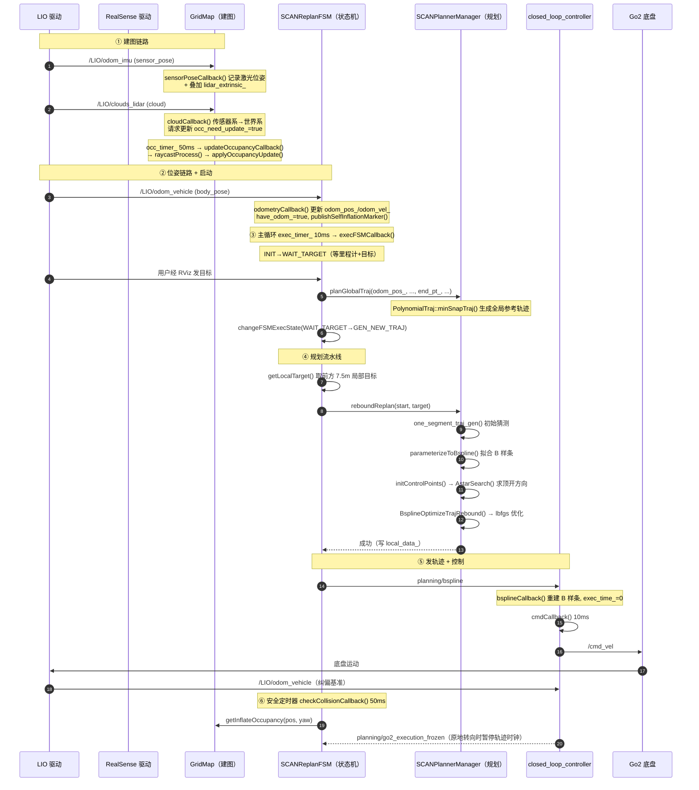

# SCAN-Planner 代码文件说明

本文逐文件说明仓库中每个代码文件**实现的功能**与**在系统中的作用**，用于帮助第一次接触本项目的人建立整体认识。

> 说明：文件内已有逐段中文注释，本文是"索引 + 概览"。看到一个文件想不起它是干什么的，来这里查即可。

---

## 目录

1. [项目是什么](#1-项目是什么)
2. [数据流总览](#2-数据流总览)
3. [目录结构](#3-目录结构)
4. [逐文件说明 —— 规划器](#4-逐文件说明规划器-srcplanner)
5. [逐文件说明 —— 仿真](#5-逐文件说明仿真-srcsimulator)
6. [逐文件说明 —— 仓库根目录](#6-逐文件说明仓库根目录)
7. [关键话题一览](#7-关键话题一览)
8. [建议的阅读顺序](#8-建议的阅读顺序)
9. [可以跳过的文件](#9-可以跳过的文件)
10. [数据流通图（含函数名）](#10-数据流通图含函数名)
11. [数据流逐阶段详解](#11-数据流逐阶段详解)
12. [真机部署专题：完整输入输出流通](#12-真机部署专题完整输入输出流通节点--话题--函数)
13. [配置参数逐个详解](#13-配置参数逐个详解)

> **配套深挖文档**：`docs/代码文件逐项详解.md` —— 逐个拆解头文件里的**每个声明**（枚举的每个值、结构体的每个成员、每个函数原型）。目前已覆盖 `scan_replan_fsm.h` 与 `planner_manager.h`。

---

## 1. 项目是什么

**SCAN-Planner** 是面向**四足机器人（宇树 Go2）长距离导航**的**局部规划器**。

一句话概括它的工作：

> 接收「机器人当前位姿 + 一条参考路线 + 激光/深度传感器数据」，
> 实时重建机器人周围的栅格地图，用 **A\* + B 样条优化** 规划出一条平滑、无碰撞的局部轨迹，
> 再交给控制器转成速度指令驱动底盘。

本分支 `ros2-community` 是把原 ROS 1 项目（[wuyi2121/SCAN-Planner](https://github.com/wuyi2121/SCAN-Planner)）移植到 **ROS 2 Humble / Ubuntu 22.04 / colcon** 的版本。

几个需要提前知道的"命名落差"：

| 目录名 | 实际包名 | 说明 |
|---|---|---|
| `src/planner/plan_manage` | **`scan_planner`** | 目录名与包名不一致，所有 launch/config 都用 `scan_planner` |
| `src/simulator/local_sensing` | `local_sensing_node` | 同理 |
| 根目录的 `SCAN-Planner/` | —— | 是本仓库的**重复副本**（未被 git 跟踪），不要看它 |

---

## 2. 数据流总览

```
【仿真侧】                                   【算法侧】
mockamap_node / map_pub
   │ /map_generator/global_cloud
   ▼
pcl_render_node / opengl_render_node   ← 传感器仿真器
   │ /quad_0/cloud（激光）
   │ /quad_0/depth + /quad_0/lidar_pose（深度模式）
   ▼
┌──────────────────────── scan_planner_node ────────────────────────┐
│  GridMap（建图）                                                    │
│     │                                                              │
│     ▼                                                              │
│  A*（绕障引导）→ UniformBspline（拟合）→ BsplineOptimizer（L-BFGS）│
│     │                                                              │
│     ▼                                                              │
│  SCANReplanFSM（状态机，决定何时规划、何时急停）                     │
└──────────────────────────────┬────────────────────────────────────┘
                               │ planning/bspline
                               ▼
                    closed_loop_controller
                               │ cmd_vel
                               ▼
              go2_kinematic_sim（假机器人）/ 真实底盘
                               │ body_pose
                               └──────────► 回到最上面（闭环）
```

---

## 3. 目录结构

```
SCAN-Planner/
├── README.md             项目说明（编译、启动、参数）
├── NOTICE                版权与来源声明（ROS 2 移植说明）
├── LICENSE               Apache-2.0
├── .gitignore            git 忽略规则
├── map.pcd               示例点云地图
├── assets/               图片与演示动图（二进制）
├── tools/README.md       航点录制脚本的用法说明
├── docs/                 本说明文档所在目录
└── src/
    ├── planner/          ★ 算法本体（6 个包）
    │   ├── plan_manage/      主节点、状态机、控制器、launch、config
    │   ├── plan_env/         栅格地图 + 射线投射
    │   ├── path_searching/   网格 A*
    │   ├── bspline_opt/      B 样条表示 + 轨迹优化器
    │   ├── traj_utils/       全局多项式轨迹 + RViz 可视化
    │   └── scan_planner_msgs/ 自定义消息
    └── simulator/        仿真环境（"假世界"）
        ├── mockamap/         程序化随机地图
        ├── map_generator/    读取 PCD 地图
        ├── local_sensing/    传感器仿真（CPU / GPU 两套）
        └── Utils/            机器人模型、可视化、工具库
```

---

## 4. 逐文件说明（规划器 `src/planner/`）

### 4.1 `plan_manage`（包名 `scan_planner`）—— 决策与调度层

这是整个项目的**指挥中心**，包含主程序、状态机、规划调度器和控制器。

| 文件 | 行数 | 功能与作用 |
|---|---|---|
| `src/scan_planner_node.cpp` | 66 | **程序入口**。初始化 ROS 2、创建 `scan_planner_node` 节点、构造状态机 `SCANReplanFSM` 并调用 `init()`，然后用单线程执行器一直运行。真正的逻辑都在 `init()` 里。 |
| `src/scan_replan_fsm.cpp` | 1685 | **状态机实现（全项目最重要的文件）**。每 10ms 执行一次的 `execFSMCallback()` 驱动六个状态（INIT / WAIT_TARGET / GEN_NEW_TRAJ / REPLAN_TRAJ / EXEC_TRAJ / EMERGENCY_STOP）；每 50ms 的 `checkCollisionCallback()` 沿轨迹前 2/3 做碰撞检查。还包括：目标点处理（`waypointCallback`）、三种导航模式、航点序列推进、取局部目标（`getLocalTarget`）、重规划（`planFromCurrentTraj`）、紧急停止、以及"底盘原地转向时暂停轨迹时钟"（`updateLocalTrajTimeFreeze`）。 |
| `include/plan_manage/scan_replan_fsm.h` | 226 | 状态机的**声明**：六个状态枚举、三种导航模式、全部成员变量与函数原型。 |
| `src/planner_manager.cpp` | 768 | **规划调度器实现**。核心是 `reboundReplan()`：它把「初始猜测路径 → z 拉平 → 拟合 B 样条 → A\* 求脱困方向 → L-BFGS 优化 → 时间重分配 → 可行性检查」串成一条流水线；只要任何一步不安全就整条丢弃不发布。另外包含全局轨迹生成 `planGlobalTraj` / `planGlobalTrajWaypoints`、紧急停止 `EmergencyStop`、轨迹记录 `updateTrajInfo`。 |
| `include/plan_manage/planner_manager.h` | 108 | 调度器的**声明**，并暴露 `local_data_` / `global_data_` / `grid_map_` 给状态机直接访问。 |
| `include/plan_manage/plan_container.hpp` | 268 | 三个**数据盒子**：`GlobalTrajData`（全局参考轨迹，含"某时刻该在哪/速度/加速度"的查询）、`PlanParameters`（物理限制参数）、`LocalTrajData`（当前执行的局部轨迹）。 |
| `src/closed_loop_controller.cpp` | 300 | **闭环控制器**。订阅规划轨迹与里程计，每 10ms 用 `cmdCallback()` 算出速度指令：前瞻取点定朝向 → 朝向差太大先原地转向（并发 `planning/go2_execution_frozen` 让规划器暂停轨迹时钟）→ 否则"前馈速度 + 位置误差比例修正"，转成机体系后发 `cmd_vel`。 |
| `src/open_loop_controller.cpp` | 224 | **开环控制器**。不做控制计算，直接把规划轨迹上的点当作"真实里程计"发布出去（理想执行），用于单独观察规划结果。 |
| `src/go2_kinematic_sim.cpp` | 199 | **假机器人（运动学仿真）**。订阅 `cmd_vel`，用最简单的二维积分 `x += v·dt`、`yaw += ω·dt` 更新位置，再发布 `body_pose`，从而与控制器构成闭环。0.3 秒收不到指令就自动停车（失联保护）。 |
| `src/go2_gait_publisher.cpp` | 208 | **步态动画**。根据当前速度虚拟生成 12 个关节角并发布 `joint_states`，只为让 RViz 里的 Go2 腿动起来，**不参与规划与控制**。 |
| `launch/run.launch.py` | 367 | **最常用的启动入口**。根据 `is_real_world` 决定话题接线（真机接 `/LIO/*`，仿真接 `/quad_0/*`），启动规划器、机器人模型、控制器，仿真时再拉起 `simulator.launch.py`。 |
| `launch/simulator.launch.py` | 167 | **仿真环境**：造地图（`mockamap` 或 `map_generator`）→ 传感器仿真（`pcl_render_node` / `opengl_render_node`）→ 里程计可视化。真机模式下什么都不启动。 |
| `launch/rviz.launch.py` | 35 | 打开 RViz2 并加载本项目预设的显示配置。 |
| `launch/default.rviz` | 538 | RViz2 显示配置（显示哪些话题、颜色、尺寸）。内容为配置项列表，按需查阅。 |
| `config/planner.yaml` | 120 | **规划器参数**：`fsm.*`（导航模式、重规划阈值）、`grid_map.*`（分辨率、膨胀、概率模型、相机内参）、`manager.*`（最大速度/加速度）、`optimization.*`（各代价项权重）。 |
| `config/controllers.yaml` | 79 | 四个节点的参数：闭环控制器（增益、限速）、开环控制器（发布频率、初始位姿）、运动学仿真（初始位姿、失联超时）、步态发布器（步频、摆幅）。 |
| `config/simulator.yaml` | 95 | 仿真参数：`mockamap_node`（地图类型、尺寸、种子）、`pcl_render_node`（视场、射程、扫描图案、相机内参）、`odom_visualization`。 |
| `config/robots/*.yaml` | 74 / 58 / 52 | **机型档案**（`a2` / `go2` / `go2w`）：把「机器人相关」的参数、真机话题名与初始位置从通用默认里抽出来，换机型只要加一个文件、启动时 `robot:=<机型>`。碰撞几何三机型统一公式：`offset = L/4`、`radius = hypot(L/4, W/2)`（两圆并集正好覆盖站立投影矩形）。 |
| `config/keypoints.example.yaml` | 19 | 预设航点示例（`navi_mode=2` 用），`fsm.waypoints` 为平铺的 xyz 三元组数组。 |
| `scripts/keypoint_recorder.py` | 170 | **航点录制工具**（rclpy）。手动开动机器人到想去的点，按键盘把当前位置记成航点并保存成 YAML。 |
| `test/test_planner_startup.py` | 44 | 冒烟测试：带 `planner.yaml` 启动规划器，确认能正常启动（不检查规划结果）。 |
| `test/test_waypoint_parameters.py` | 42 | 冒烟测试：额外加载航点文件，确认平铺航点数组能被正确读入。 |
| `CMakeLists.txt` | 119 | 构建脚本：生成 5 个可执行程序（规划器、两个控制器、假机器人、步态发布器），安装 launch/config/脚本。 |
| `package.xml` | 63 | 包的依赖清单。 |

### 4.2 `plan_env` —— 栅格地图与射线投射

**局部滑动栅格地图**：把机器人周围的空间切成小立方体，记录每格"被占据的可能性"，并回答"这个位置能不能站"。

| 文件 | 行数 | 功能与作用 |
|---|---|---|
| `include/plan_env/grid_map.h` | 666 | 地图类 `GridMap` 的声明：参数结构 `MappingParameters`、运行时数据 `MappingData`（含三块核心缓冲区）、坐标↔索引换算、**碰撞查询 `getInflateOccupancy(pos, yaw)`**（双圆柱机器人模型）、以及各类发布函数。**本项目没有 ESDF（距离场）**，碰撞只靠"占据概率 + 膨胀"。 |
| `src/grid_map.cpp` | 1461 | 地图的实现。`initMap()` 读参数建缓冲区；`updateOccupancyCallback()`（50ms 定时器）→ `raycastProcess()` 沿每条光束做体素遍历、把命中/空闲累积成 log-odds 概率；`applyOccupancyUpdate()` 跨过门槛即判为障碍并更新膨胀层（引用计数防误清）；`updateSlidingMap()` 让地图随机器人滑动；另有深度图反投影、激光/深度两种回调、以及各类 RViz 发布函数。 |
| `include/plan_env/raycast.h` | 86 | 射线穿格算法的声明（Amanatides-Woo 体素遍历）：`Raycast()` 与可逐步前进的 `RayCaster` 类。 |
| `src/raycast.cpp` | 382 | 射线穿格实现：从起点格子出发，每一步比较三个方向的"下次跨界步数"，谁最小就先跨谁。 |
| `CMakeLists.txt` | 57 | 构建库 `plan_env`，依赖 PCL / OpenCV / cv_bridge / message_filters / tf2。 |
| `package.xml` | 31 | 依赖清单。 |

### 4.3 `path_searching` —— 网格 A\*

**A\* 寻路**：在轨迹撞上障碍时，用来找一条绕行路线，进而算出"该把控制点往哪边推"。

| 文件 | 行数 | 功能与作用 |
|---|---|---|
| `include/path_searching/dyn_a_star.h` | 158 | `AStar` 类与搜索节点 `GridNode` 的声明。注意：虽然文件名带 "dyn"，**实现其实是普通网格 A\***，没有速度/加速度状态，输出是纯位置点列。 |
| `src/dyn_a_star.cpp` | 411 | A\* 实现。`AstarSearch()` 是主体：把起终点转成格子、构造"只沿起点→终点连线附近搜索"的平面（z 由插值决定）、用 `fScore` 最小的优先队列向 XY 八邻域扩展、用带朝向的碰撞检测判断可通行性、找到终点后沿 `cameFrom` 倒推路径。硬编码 0.2 秒搜索超时。 |
| `CMakeLists.txt` | 37 | 构建库 `path_searching`。 |
| `package.xml` | 20 | 依赖清单。 |

### 4.4 `bspline_opt` —— B 样条与轨迹优化（算法核心）

| 文件 | 行数 | 功能与作用 |
|---|---|---|
| `include/bspline_opt/uniform_bspline.h` | 153 | **B 样条曲线**类声明：控制点、阶数、节点向量；求值 `evaluateDeBoorT`、求导 `getDerivative`、拟合 `parameterizeToBspline`、可行性检查与时间拉伸。 |
| `src/uniform_bspline.cpp` | 465 | B 样条实现。`evaluateDeBoor()`（De Boor 递推求值）、`getDerivative()`（导数控制点 = 相邻控制点差分）、`checkFeasibility()`（逐段检查速度/加速度）、`lengthenTime()`（拉长时间轴）、`parameterizeToBspline()`（**解线性方程组反求控制点**，用 (1,4,1)/6 的位置方程 + 速度/加速度边界条件）。 |
| `include/bspline_opt/bspline_optimizer.h` | 206 | **优化器**类声明：代价权重 `lambda1~4`、代价项计算函数、L-BFGS 求解流程、`ControlPoints` 辅助结构（记录每个控制点的推出方向）。 |
| `src/bspline_optimizer.cpp` | 1483 | **全项目算法核心**。`initControlPoints()` 找出碰撞段、对每段跑 A\*、用"投影值符号翻转"求控制点连线与 A\* 路径的交点以确定推出方向；四个代价项 `calcSmoothnessCost`（jerk）/ `calcDistanceCostRebound`（避障）/ `calcFeasibilityCost`（超限）/ `calcFitnessCost`（贴合）；`combineCostRebound` / `combineCostRefine` 加权求和并**把 z 方向梯度清零**；`rebound_optimize` / `refine_optimize` 驱动 L-BFGS 并处理"发现新障碍就重启"。 |
| `include/bspline_opt/gradient_descent_optimizer.h` | 68 | 梯度下降优化器的声明。 |
| `src/gradient_descent_optimizer.cpp` | 138 | 梯度下降的实现。**本项目从未调用它**（实际用的是 L-BFGS），属上游遗留。 |
| `include/bspline_opt/lbfgs.hpp` | 1465 | **第三方数值库**（L-BFGS，作者 Naoaki Okazaki）。轨迹优化就是靠它找最优控制点。了解接口即可，不必细读。 |
| `test/test_uniform_bspline.cpp` | 39 | 单元测试：验证 B 样条求值与求导的正确性。 |
| `CMakeLists.txt` | 50 | 构建库 `bspline_opt`。 |
| `package.xml` | 23 | 依赖清单（含 `path_searching`、`plan_env`）。 |

### 4.5 `traj_utils` —— 全局轨迹与可视化

| 文件 | 行数 | 功能与作用 |
|---|---|---|
| `include/traj_utils/polynomial_traj.h` | 369 | **多项式轨迹**类声明：分段多项式（x/y/z 系数 + 每段时长）、求值/求速度/求加速度、以及两个静态工厂 `minSnapTraj` / `one_segment_traj_gen`。 |
| `src/polynomial_traj.cpp` | 281 | 多项式轨迹实现。`minSnapTraj()` 用"最小化四阶导(snap)"的闭式解连接多个途经点（构造选择矩阵、代价矩阵 Q、解 `Rpp⁻¹Rfpᵀ`）；`one_segment_traj_gen()` 解一个 6×6 方程组得到单段五次多项式。 |
| `include/traj_utils/planning_visualization.h` | 79 | 可视化类声明：五个 Marker 发布器与各类"画图"接口。 |
| `src/planning_visualization.cpp` | 398 | 可视化实现：画目标点（白球）、全局路径（青色）、初始路径（蓝色）、最优轨迹（**颜色随速度绿→红渐变**）、A* 路径（每段随机色）。只负责显示，不参与计算。 |
| `CMakeLists.txt` | 33 | 构建库 `traj_utils`。 |
| `package.xml` | 20 | 依赖清单。 |

### 4.6 `scan_planner_msgs` —— 自定义消息

| 文件 | 行数 | 功能与作用 |
|---|---|---|
| `msg/Bspline.msg` | 25 | **规划器发布轨迹用的消息**：`order`（阶数）、`traj_id`、`start_time`、`knots`（节点向量）、`pos_pts`（控制点）。`yaw_pts` / `yaw_dt` 为预留字段，从未赋值。 |
| `msg/DataDisp.msg` | 16 | 调试数据显示用：`header` + 五个预留浮点槽位 `a~e`（本项目只用到时间戳）。 |
| `CMakeLists.txt` | 22 | 用 `rosidl` 生成消息代码。 |
| `package.xml` | 25 | 依赖清单。 |

---

## 5. 逐文件说明（仿真 `src/simulator/`）

仿真这一整块的作用是：**造一个假世界，并假装成传感器，把数据喂给规划器**。学习算法时可以最后再看。

### 5.1 `mockamap` —— 程序化随机地图

| 文件 | 行数 | 功能与作用 |
|---|---|---|
| `src/mockamap.cpp` | 122 | 随机地图生成**节点**。读参数（种子、尺寸、分辨率、类型），委托 `Maps` 生成点云，发布到 `mock_map`（launch 里重映射为 `/map_generator/global_cloud`），并定时重复发布。另含一个未被调用的地图瘦身函数 `optimizeMap`。 |
| `src/maps.cpp` | 1022 | **四种地图生成算法**：`perlin3D()`（柏林噪声地形）、`randomMapGenerate()`（随机撒立方体表面点）、`maze2D()`（2D 迷宫递归分割后竖直拉伸）、`Maze3DGen()`（核心点 + 中面墙的 3D 迷宫）。 |
| `include/maps.hpp` | 96 | 上述算法的声明，以及参数/结果容器 `BasicInfo` 和 3D 迷宫用的 `MazePoint`。 |
| `src/perlinnoise.cpp` | 153 | 柏林噪声实现（第三方：Ken Perlin 官方实现的 C++ 翻译）。 |
| `include/perlinnoise.hpp` | 45 | 柏林噪声类声明。 |
| `config/rviz.rviz` | 44 | 地图生成用的 RViz2 配置。 |
| `src/.clang-format` | 18 | 该目录的代码格式化规范。 |
| `CMakeLists.txt` / `package.xml` | 32 / 23 | 构建脚本与依赖。 |

### 5.2 `map_generator` —— 读取 PCD 地图

| 文件 | 行数 | 功能与作用 |
|---|---|---|
| `src/map_publisher.cpp` | 107 | **PCD 地图发布节点**。读取点云文件（可加偏移、可体素下采样），转成 ROS 消息后按频率重复发布到 `global_cloud`。这是"用真实场景地图做仿真"的入口（`use_pcd_map:=true`）。 |
| `CMakeLists.txt` / `package.xml` | 26 / 19 | 构建脚本与依赖。 |

### 5.3 `local_sensing` —— 传感器仿真（CPU / GPU 两套）

| 文件 | 行数 | 功能与作用 |
|---|---|---|
| `src/pointcloud_render_node.cpp` | 2367 | **CPU 版传感器仿真（默认路径）**。它把全局地图当真实世界，根据机器人位姿渲染出激光点云或深度图。核心 `renderSensedPoints()` 分三遍：① 把视野内的点投到"极坐标深度图"（远近做不同处理）② 用每个点的法线做"面插值"，把离散点补成连续表面 ③ 把极坐标图还原成 3D 点云。还会按激光型号生成"扫描图案"以模拟真实激光的稀疏纹理；深度模式走另一条更简单的路径 `publishPinholeDepth()`。 |
| `src/opengl_render_node.cpp` | 1317 | **GPU 版传感器仿真**（需 `-DUSE_GPU=ON` 编译）。功能与 CPU 版等价，但把点云画到 OpenGL 的隐藏窗口上，由显卡的深度缓冲完成"遮挡判断"。核心调用只有两行：`render.input_dyn_clouds()` 与 `render.render_pointcloud()`。 |
| `include/opengl_sim.hpp` | 2584 | GPU 渲染器的实现。关键函数：`render_pointcloud`（生成扫描图案 → 设相机 → 画点 → 读深度缓冲）、`read_depth`（把非线性深度线性化）、`depth_to_pointcloud`（深度图反投影成点云）、以及大量 OpenGL 样板与调试函数。 |
| `include/tools_kd_hash.hpp` | 254 | **第三方**（R3LIVE）：三维哈希表，用坐标直接存取体素，代替三维数组以节省内存。 |
| `include/ikd-Tree/ikd_Tree.h` / `.cpp` | 231 / 1503 | **第三方**：ikd-Tree 增量式 KD 树（支持随时加点删点而不必整树重建）。本项目中被 `FOV_Checker` 用于视场检查。 |
| `include/FOV_Checker/FOV_Checker.h` / `.cpp` | 56 / 494 | **第三方**：快速视场检查。把环境切成体素方块，只判断"哪些方块与视锥相交"，从而缩小需要检查的点集。 |
| `include/360camera.vs` | 156 | **GPU 渲染的核心着色器**。它做的不是普通透视投影，而是**极坐标投影**：横坐标←水平角、纵坐标←竖直角、深度←距离。显卡深度缓冲自动保留每格最近点，即实现遮挡。 |
| `include/camera.vs` / `camera.fs` | 28 / 20 | 备用着色器（常规透视投影）。本项目默认不使用。 |
| `include/shader_m.h` | 184 | **第三方**（LearnOpenGL）：着色器编译/链接的封装类，并提供向着色器传参数的 `setXxx` 函数。 |
| `include/filesystem.h` | 64 | **第三方**（LearnOpenGL）：资源路径查找工具。本项目实际未使用。 |
| `params/camera.yaml` | 15 | 单独一份深度相机内参（调试用）。 |
| `CMakeLists.txt` | 67 | 构建脚本：`pcl_render_node` 总是构建；`opengl_render_node` 仅在开启 `USE_GPU` 时构建。 |
| `package.xml` | 26 | 依赖清单。 |

### 5.4 `Utils/odom_visualization` —— 机器人可视化

| 文件 | 行数 | 功能与作用 |
|---|---|---|
| `src/odom_visualization.cpp` | 196 | 订阅里程计，在 RViz 里画出：当前位置（`pose`）、历史轨迹（`path` / `trajectory`）、速度箭头（`velocity`）、机器人模型（`robot`）、高度（`height`），并可选广播 `world→base` 的 TF。 |
| `meshes/hummingbird.mesh` | 13641 | 默认的机器人外观模型（二进制网格数据）。 |
| `CMakeLists.txt` / `package.xml` | 33 / 25 | 构建脚本与依赖。 |

### 5.5 `Utils/waypoint_generator` —— 目标点转路径

| 文件 | 行数 | 功能与作用 |
|---|---|---|
| `src/waypoint_generator.cpp` | 87 | 小工具：在 RViz 里点一个目标点，就把「当前位置 → 目标点」组成一条路径发布出去。**本项目的 launch 未启动它**，属独立工具。 |
| `CMakeLists.txt` / `package.xml` | 20 / 18 | 构建脚本与依赖。 |

### 5.6 `Utils/pose_utils` —— 位姿数学库（**本项目未使用**）

| 文件 | 行数 | 功能与作用 |
|---|---|---|
| `include/pose_utils.h` | 67 | 声明：旋转/四元数换算、位姿复合与求逆、位姿 EKF 与 IMU EKF 的雅可比。 |
| `src/pose_utils.cpp` | 557 | 上述函数的实现（基于 Armadillo）。**迁移到本项目后已无任何调用者**，属历史遗留，可完全跳过。 |
| `CMakeLists.txt` / `package.xml` | 25 / 16 | 构建脚本与依赖。 |

### 5.7 `Utils/go2_description` —— Go2 模型与 Gazebo 集成

| 文件 | 行数 | 功能与作用 |
|---|---|---|
| `xacro/robot.xacro` | 165 | **机器人总模型**。定义刚体与关节层次：`base`（虚拟根）→ `trunk`（躯干）→ { IMU、前置相机、四条腿 }。`use_gazebo` 控制是否包含物理仿真部分。规划器启动时用的是 `use_gazebo:=false` 的版本（只用于 RViz 显示）。 |
| `xacro/leg.xacro` | 298 | "一条腿"的宏（髋 + 大腿 + 小腿 + 脚 + 转子），被调用 4 次并靠参数区分左右/前后。 |
| `xacro/const.xacro` | 182 | 全部尺寸、关节限位、质量与惯量的**常量表**。 |
| `xacro/materials.xacro` | 46 | 颜色定义。 |
| `xacro/gazebo.xacro` | 54 | Gazebo 相关配置：四个足端接触传感器、IMU 传感器、`gz_ros2_control` 插件。 |
| `xacro/ros2_control.xacro` | 48 | 12 个关节的 ros2_control 配置（位置指令 + 位置/速度状态）。 |
| `launch/go2_sim.launch.py` | 135 | 在 Gazebo Fortress 里生成 Go2：启动仿真器、`robot_state_publisher`、话题桥接、生成机器人、加载两个控制器。 |
| `launch/go2_rviz.launch.py` | 48 | 不开物理仿真，只用 RViz + 关节滑条检查模型。 |
| `launch/check_joint.rviz` | 43 | 关节检查用的 RViz 配置。 |
| `config/ros2_controllers.yaml` | 48 | 控制器管理器配置（200Hz，加载 `joint_state_broadcaster` 与 `joint_trajectory_controller`）。 |
| `config/bridge.yaml` | 47 | ROS ↔ Gazebo 的话题桥接（时钟、IMU、TF、四个足端接触）。 |
| `worlds/empty.sdf` | 50 | Gazebo 的"空世界"：重力、阳光、100×100 米地面。 |
| `dae/*.dae`（7 个） | 95~223 | 各部件的外观模型（COLLADA 3D 网格数据，二进制性质）。 |
| `meshes/*.dae`（7 个） | 95~223 | 与 `dae/` 内容相同（不同引用路径）。 |
| `urdf/*.png`（2 个） | 673 / 700 | 碰撞模型示意图（图片）。 |
| `README.md` | 19 | 本包的简短说明。 |
| `CMakeLists.txt` / `package.xml` | 17 / 35 | 只安装资源文件 / 依赖清单。 |

### 5.8 `Utils/a2_description` —— A2 模型（仅 RViz 显示）

| 文件 | 行数 | 功能与作用 |
|---|---|---|
| `urdf/a2.urdf` | 1103 | **A2 机器人总模型**（纯 URDF，不用 xacro）。层级：`base`（虚拟根）→ `base_link`（机身，19.65 kg）→ 四条腿 `{FL,FR,RL,RR}_hip/_thigh/_calf/_foot`（每腿 3 个旋转关节 + 1 个固定脚关节），另有 `camera_link` / `front_lidar_link` / `rear_lidar_link` 三个传感器坐标系，共 21 link / 20 joint。 |
| `meshes/*.STL`（17 个） | 二进制 | 机身与各腿段的外观网格，合计约 15 MB。 |
| `launch/a2_rviz.launch.py` | 52 | 不开物理仿真，只用 RViz + 关节滑条检查 A2 模型（对应 Go2 的 `go2_rviz.launch.py`）。 |
| `launch/a2.rviz` | 43 | 模型检查用的 RViz 配置（固定坐标系 `base`）。 |
| `README.md` | 40 | 本包说明：来源、相对原始文件的改动、结构与注意事项。 |
| `CMakeLists.txt` / `package.xml` | 17 / 26 | 只安装资源文件 / 依赖清单。 |

**来源与 3 处改动**：取自 A2 实机 `/home/unitree/agile-nav/static/robot/`，相对原始文件只改了：① 网格路径 `../meshes/*.STL` → `package://a2_description/meshes/*.STL`（17 处）；② 顶部补虚拟根 `base` 及固定关节 `base → base_link`（仿真的 TF 约定是 `world → base`，不补会与 TF 脱链、模型跑到原点）；③ SolidWorks 导出遗留的空材质名 `<material name="">` → `a2_mat_N`（17 处）。

**注意**：本包只装 `urdf` 与 `meshes`，没有 Gazebo / `ros2_control` 部分（那些只在 `go2_description` 里有）。A2 的关节名与 Go2 不同，`go2_gait_publisher` 不会驱动它，所以仿真里 A2 呈现为**静态站姿**——用来对照碰撞 footprint 已经足够。

---

### 5.9 `Utils/go2w_description` —— Go2-W 模型（由 Go2 派生）

| 文件 | 行数 | 功能与作用 |
|---|---|---|
| `xacro/*.xacro`（6 个） | 796 | 与 `go2_description/xacro/` 同名的六份 xacro，只把 `<xacro:include>` 指向本包。**关节名与关节轴和 Go2 完全一致**，因此 `go2_gait_publisher` 可直接驱动。 |
| `README.md` | 17 | 说明派生方式与限制。 |
| `CMakeLists.txt` | 13 | 只安装 xacro 资源。 |
| `package.xml` | 20 | 依赖清单（`exec_depend: go2_description`——网格仍引用它的约 25 MB 文件，不复制）。 |

**为什么是派生的**：宇树没有发布 Go2-W 的官方 URDF。本包按官方站立尺寸（0.70×0.43×0.50）相对 Go2（0.70×0.31×0.40）缩放：躯干网格 `1 × 1.387 × 1.25`、`trunk_width/height` 与 `leg_offset_y / hip_offset_y` 同比例放大；**腿长沿用 Go2**（官方未给），所以站立高度偏矮于 0.50 m。拿到官方模型后整包替换即可。

## 6. 逐文件说明（仓库根目录）

| 文件 | 行数 | 功能与作用 |
|---|---|---|
| `README.md` | 251 | 项目说明：编译步骤、启动命令、导航模式（`navi_mode` 1/2/3）、控制器模式、参数与接口、Gazebo 仿真说明。**建议第一个读**。 |
| `NOTICE` | 22 | 版权与来源声明：说明这是 ROS 2 移植版、原项目与原作者是谁。**请勿修改**。 |
| `LICENSE` | 201 | Apache-2.0 许可证全文。**请勿修改**。 |
| `.gitignore` | 58 | git 忽略规则：编译产物、运行时状态、Python 缓存、编辑器临时文件等。 |
| `map.pcd` | 66647 | 示例点云地图（二进制），配合 `use_pcd_map:=true` 使用。 |
| `assets/images/*.jpg` | 2996 / 15502 | README 里用的示意图（图片）。 |
| `assets/gif/*.gif` | 4 个 | 演示动图（图片）。 |
| `tools/README.md` | 11 | 航点录制脚本（`keypoint_recorder.py`）的用法说明。 |
| `docs/代码文件说明.md` | —— | 本文档。 |

---

## 7. 关键话题一览

| 话题 | 类型 | 谁发布 | 谁订阅 | 含义 |
|---|---|---|---|---|
| `body_pose` | `nav_msgs/Odometry` | 假机器人 / 真机 LIO | 规划器、控制器、可视化 | 机器人当前位姿与速度 |
| `cmd_vel` | `geometry_msgs/Twist` | 闭环控制器 | 假机器人 / 真机底盘 | 速度指令（前进/横移/转向） |
| `planning/bspline` | `scan_planner_msgs/Bspline` | 规划器 | 控制器 | 规划出的 B 样条轨迹 |
| `planning/go2_execution_frozen` | `std_msgs/Bool` | 闭环控制器 | 规划器 | "我在原地转向，请暂停轨迹时钟" |
| `move_base_simple/goal` | `geometry_msgs/PoseStamped` | RViz | 规划器（`navi_mode=1`） | 手动点选的目标点 |
| `initial_path` | `nav_msgs/Path` | 外部 | 规划器（`navi_mode=3`） | 外部给的全局参考路径 |
| `/map_generator/global_cloud` | `sensor_msgs/PointCloud2` | 造地图节点 | 传感器仿真器 | 全局地图 |
| `/quad_0/cloud` | `sensor_msgs/PointCloud2` | 传感器仿真器 | 规划器 | 仿真激光点云 |
| `/quad_0/depth` | `sensor_msgs/Image` | 传感器仿真器 | 规划器 | 仿真深度图 |
| `/quad_0/lidar_pose` / `camera_pose` | `nav_msgs/Odometry` | 传感器仿真器 | 规划器 | 传感器位姿 |
| `grid_map/occupancy`、`occupancy_inflate`、`sliding_map_bbox` | 点云 / Marker | 规划器（GridMap） | RViz | 地图可视化 |
| `goal_point`、`global_list`、`init_list`、`optimal_list`、`a_star_list`、`self_inflation` | `Marker` | 规划器 | RViz | 规划过程可视化 |

---

## 8. 建议的阅读顺序

按"从外到内、从流程到细节"分层，每层读完再进下一层。

**第 0 层：整体印象**
1. `README.md` → 2. `NOTICE` → 3. 记住目录二分法（`planner` 是算法、`simulator` 是假世界）

**第 1 层：谁启动谁、话题怎么连**
4. `launch/run.launch.py` → 5. `launch/simulator.launch.py` → 6. `config/planner.yaml` → 7. `src/scan_planner_node.cpp`

**第 2 层：主线流程（最关键）**
8. `include/plan_manage/scan_replan_fsm.h` → `src/scan_replan_fsm.cpp`
（先只读 `execFSMCallback` 与 `checkCollisionCallback`）
9. `include/plan_manage/planner_manager.h` → `src/planner_manager.cpp`
（重点 `reboundReplan`）
10. `include/plan_manage/plan_container.hpp`

**第 3 层：算法三件套**
11. `plan_env/grid_map.h` → `src/grid_map.cpp`（先看 `getInflateOccupancy`）
12. `bspline_opt/uniform_bspline.h` → `src/uniform_bspline.cpp`
13. `bspline_opt/bspline_optimizer.h` → `src/bspline_optimizer.cpp`
14. `path_searching/dyn_a_star.h` → `src/dyn_a_star.cpp`
15. `traj_utils/polynomial_traj.h` → `src/polynomial_traj.cpp`
16. `scan_planner_msgs/msg/Bspline.msg`

**第 4 层：控制闭环**
17. `src/closed_loop_controller.cpp`（看 `cmdCallback`）
18. `src/go2_kinematic_sim.cpp`
19. `src/open_loop_controller.cpp`、`src/go2_gait_publisher.cpp`

**第 5 层：仿真世界（非必需）**
20. `src/simulator/mockamap/src/maps.cpp` → `src/mockamap.cpp`
21. `src/simulator/map_generator/src/map_publisher.cpp`
22. `src/simulator/local_sensing/src/pointcloud_render_node.cpp`
23. `src/simulator/Utils/odom_visualization/src/odom_visualization.cpp`
24. `src/simulator/Utils/go2_description/xacro/robot.xacro`、`gazebo.xacro`

**只有很少时间时的最小路径**
`README.md` → `run.launch.py` → `scan_replan_fsm.cpp` 的 `execFSMCallback` → `planner_manager.cpp` 的 `reboundReplan` → `grid_map.h` 的 `getInflateOccupancy` → `closed_loop_controller.cpp` 的 `cmdCallback`。

---

## 9. 可以跳过的文件

以下文件**不影响理解规划流程**，用到时再查：

| 类别 | 文件 | 原因 |
|---|---|---|
| 第三方库 | `bspline_opt/lbfgs.hpp`、`local_sensing/ikd-Tree/*`、`local_sensing/FOV_Checker/*`、`local_sensing/tools_kd_hash.hpp`、`local_sensing/shader_m.h`、`local_sensing/filesystem.h` | 完整移植的第三方代码，知道用途即可 |
| 未使用的遗留代码 | `bspline_opt/gradient_descent_optimizer.*`、`simulator/Utils/pose_utils/*` | 本项目没有任何调用 |
| GPU 备选实现 | `local_sensing/opengl_render_node.cpp`、`opengl_sim.hpp`、`camera.vs/.fs` | 与 CPU 版功能等价，默认不走这条路 |
| 纯配置/数据 | 各种 `CMakeLists.txt`、`package.xml`、`.rviz`、`.clang-format`、`*.dae`、`*.png`、`*.mesh`、`*.gif`、`*.jpg`、`map.pcd` | 参数表 / 二进制资源 |
| 法律与说明文件 | `LICENSE`、`NOTICE`、各 `README.md` | 本身就是对外声明与文档 |

---

## 10. 数据流通图（含函数名）

本节的场景：**仿真模式**（`is_real_world:=false`）+ **激光**（`sensor_type:=lidar`）+ **闭环**（`controller_mode:=closed_loop`）。

### 10.1 总览图：节点 → 话题 → 函数

```
┌──────────────────────── 【仿真侧：造世界 + 假装成传感器】 ────────────────────────┐
│                                                                                  │
│  mockamap_node / map_pub                        （程序化地图 或 读取 PCD）        │
│    Maps::generate(type)  →  publishMap()                                          │
│         │                                                                        │
│         │  话题: /map_generator/global_cloud   (sensor_msgs/PointCloud2)          │
│         ▼                                                                        │
│  pcl_render_node   （包名 local_sensing_node）                                    │
│    rcvGlobalPointCloudCallBack()  ← 下采样 / 算法线 / 建哈希体素（只做一次）      │
│    rcvOdometryCallback()          ← 记录位姿，算出 sensor2world                   │
│    renderSensedPoints()           ← 定时触发：把地图"渲染"成一帧传感器数据        │
│         │                                                                        │
│         │  话题: /quad_0/cloud        (激光点云, PointCloud2)                     │
│         │        /quad_0/lidar_pose   (传感器位姿, Odometry)                      │
└─────────┼────────────────────────────────────────────────────────────────────────┘
          │
          ▼
┌──────────────────── 【规划器】scan_planner_node ─────────────────────────────────┐
│            （包名 scan_planner ← 目录名却是 plan_manage）                          │
│                                                                                  │
│  ┌── GridMap（建图） ──────────┐   ┌── SCANReplanFSM（决策） ──────────────────┐  │
│  │  sensorPoseCallback()       │   │  odometryCallback()                       │  │
│  │  cloudCallback()            │   │        │                                  │  │
│  │        │                    │   │        ▼                                  │  │
│  │        ▼                    │   │  execFSMCallback()      (10ms 定时器)     │  │
│  │  updateOccupancyCallback()  │   │        │                                  │  │
│  │  raycastProcess()           │   │        ▼                                  │  │
│  │  setCacheOccupancy()        │   │  GEN_NEW_TRAJ / REPLAN_TRAJ               │  │
│  │  applyOccupancyUpdate()     │   │        │                                  │  │
│  │  (50ms 定时器)              │   │        ▼                                  │  │
│  │                             │   │  callReboundReplan()                      │  │
│  │  getInflateOccupancy(pos,yaw)│  │        ├─ getLocalTarget()                 │  │
│  │   ↑ 碰撞查询的最终出口       │  │        └─ reboundReplan()                 │  │
│  └─────────────────────────────┘   └──────────┬───────────────────────────────┘  │
│                                               │                                  │
│                                               ▼                                  │
│                    SCANPlannerManager::reboundReplan()   ← 核心流水线             │
│                      ① 初始猜测   PolynomialTraj::one_segment_traj_gen()         │
│                      ② 拉平高度   applyLinearZReference()                        │
│                      ③ 拟合 B样条 UniformBspline::parameterizeToBspline()        │
│                      ④ A* 定方向  BsplineOptimizer::initControlPoints()          │
│                                     └─ AStar::AstarSearch() → getPath()          │
│                      ⑤ 优化       BsplineOptimizeTrajRebound()                   │
│                                     └─ lbfgs::lbfgs_optimize()                   │
│                                         └─ combineCostRebound()                  │
│                                             ├─ calcSmoothnessCost()              │
│                                             ├─ calcDistanceCostRebound()         │
│                                             └─ calcFeasibilityCost()             │
│                      ⑥ 时间重分配 refineTrajAlgo() → reparamBspline()            │
│                      ⑦ 记录轨迹   updateTrajInfo()                               │
└───────────────────────────────────┬──────────────────────────────────────────────┘
                                    │  话题: planning/bspline (scan_planner_msgs/Bspline)
                                    ▼
┌──────────────────── 【控制器】closed_loop_controller ────────────────────────────┐
│    bsplineCallback()   ← 解析轨迹，exec_time_ = 0                                │
│    odomCallback()      ← 记录真实位姿与偏航角                                     │
│    cmdCallback()       (10ms 定时器)                                             │
│      ├─ traj_[0].evaluateDeBoorT()   取"现在该在哪"                              │
│      ├─ estimateDesiredYaw()         用前瞻点算"该朝哪"                          │
│      └─ 前馈速度 + 位置误差纠偏 → 转成机体系                                      │
└───────────────────────────────────┬──────────────────────────────────────────────┘
                                    │  话题: cmd_vel (geometry_msgs/Twist)
                                    ▼
┌──────────────────── 【机器人】go2_kinematic_sim（真机时是底盘驱动） ──────────────┐
│    cmdCallback()   ← 收到速度指令并限幅                                           │
│    simCallback()   (100Hz) ← 把机体系速度旋转到世界系，积分更新 x / y / yaw      │
│    publishOdom()                                                                 │
└───────────────────────────────────┬──────────────────────────────────────────────┘
                                    │  话题: /quad_0/body_pose (nav_msgs/Odometry)
                                    │
                                    └────► 回灌给下面 4 个订阅者 → 闭环成立
                                              │
        ┌─────────────────────┬───────────────┴──────────┬────────────────────────┐
        ▼                     ▼                          ▼                        ▼
  GridMap              SCANReplanFSM            pcl_render_node          closed_loop_controller
  (滑动地图跟随)        odometryCallback()       rcvOdometryCallback()    odomCallback()
```

### 10.2 反馈与安全支路

```
【安全支路 A】防碰撞（50ms）
  SCANReplanFSM::checkCollisionCallback()
      │  沿轨迹前 2/3，每 0.01 秒采样一次
      └─► GridMap::getInflateOccupancy(pos, estimateYawFromSegment(...))
              ├─ 能救 → planFromCurrentTraj() → 回到 EXEC_TRAJ
              └─ 救不了且来不及 → callEmergencyStop() → EMERGENCY_STOP

【反馈支路 B】执行冻结（原地转向时暂停轨迹时钟）
  closed_loop_controller
      │  话题: planning/go2_execution_frozen (std_msgs/Bool)
      └─► SCANReplanFSM::go2ExecutionFrozenCallback()
              └─► updateLocalTrajTimeFreeze()   ← 把 local_data_.start_time_ 往后推
```

### 10.3 时序图（Mermaid，支持渲染的环境可直接看图）

```mermaid
sequenceDiagram
    autonumber
    participant MAP as mockamap_node / map_pub
    participant SEN as pcl_render_node
    participant GM as GridMap
    participant FSM as SCANReplanFSM
    participant MGR as SCANPlannerManager
    participant OPT as BsplineOptimizer + AStar
    participant CTRL as closed_loop_controller
    participant SIM as go2_kinematic_sim

    MAP->>SEN: /map_generator/global_cloud
    SEN->>GM: /quad_0/cloud
    SEN->>GM: /quad_0/lidar_pose
    Note over GM: cloudCallback() → raycastProcess()<br/>→ applyOccupancyUpdate()
    SIM->>FSM: /quad_0/body_pose
    Note over FSM: odometryCallback() 更新自身状态

    Note over FSM: execFSMCallback() 10ms
    FSM->>FSM: callReboundReplan() → getLocalTarget()
    FSM->>MGR: reboundReplan(start, target)
    MGR->>MGR: parameterizeToBspline()
    MGR->>OPT: initControlPoints()
    OPT->>OPT: AstarSearch()
    MGR->>OPT: BsplineOptimizeTrajRebound()
    OPT->>OPT: combineCostRebound() + calc*Cost()
    MGR-->>FSM: 成功
    FSM->>CTRL: planning/bspline

    Note over CTRL: cmdCallback() 10ms
    CTRL->>CTRL: evaluateDeBoorT() + estimateDesiredYaw()
    CTRL->>SIM: cmd_vel
    Note over SIM: simCallback() 积分
    SIM->>FSM: /quad_0/body_pose
    SIM->>CTRL: /quad_0/body_pose
    SIM->>GM: /quad_0/body_pose
    SIM->>SEN: /quad_0/body_pose

    Note over FSM: checkCollisionCallback() 50ms
    FSM->>GM: getInflateOccupancy()
    CTRL->>FSM: planning/go2_execution_frozen
```

### 10.4 分阶段明细表

| 阶段 | 节点 | 话题（入 → 出） | 关键函数 |
|---|---|---|---|
| 1 造地图 | `mockamap_node` / `map_pub` | — → `/map_generator/global_cloud` | `Maps::generate()` → `publishMap()` |
| 2 模拟传感器 | `pcl_render_node` | `/map_generator/global_cloud`、`/quad_0/body_pose` → `/quad_0/cloud`、`/quad_0/lidar_pose` | `rcvGlobalPointCloudCallBack()` → `renderSensedPoints()` |
| 3 建图 | `scan_planner_node`（GridMap） | `/quad_0/cloud`、`/quad_0/lidar_pose` | `cloudCallback()` → `updateOccupancyCallback()` → `raycastProcess()` → `applyOccupancyUpdate()` |
| 4 拿目标 | `scan_planner_node`（FSM） | `/quad_0/body_pose`；`move_base_simple/goal` / `initial_path` | `odometryCallback()`；`rvizGoalCallback()` / `pathCallback()` → `waypointCallback()` → `planGlobalTraj()` |
| 5 规划 | `scan_planner_node`（Manager） | — | `execFSMCallback()` → `callReboundReplan()` → `getLocalTarget()` → `reboundReplan()`（内含 A\* 与 L-BFGS） |
| 6 发轨迹 | `scan_planner_node`（FSM） | — → `planning/bspline` | 打包 `scan_planner_msgs::msg::Bspline` 并发布 |
| 7 算速度 | `closed_loop_controller` | `planning/bspline`、`/quad_0/body_pose` → `cmd_vel` | `bsplineCallback()` / `odomCallback()` → `cmdCallback()` |
| 8 动起来 | `go2_kinematic_sim`（或真机底盘） | `cmd_vel` → `/quad_0/body_pose` | `cmdCallback()` → `simCallback()` → `publishOdom()` |
| 9 安全 | `scan_planner_node`（FSM） | — | `checkCollisionCallback()` → `GridMap::getInflateOccupancy()` |
| 10 冻结反馈 | `closed_loop_controller` → FSM | `planning/go2_execution_frozen` | `go2ExecutionFrozenCallback()` → `updateLocalTrajTimeFreeze()` |

### 10.5 真机模式（`is_real_world:=true`）的差异

不改任何代码，只改话题接线（由 `run.launch.py` 完成），并且**不启动任何仿真节点**——阶段 1、2、8 由真实设备与驱动替代。

| 节点内的话题名 | 仿真接到 | 真机接到 |
|---|---|---|
| `body_pose` | `/quad_0/body_pose` | `/LIO/odom_vehicle` |
| `sensor_pose` | `/quad_0/lidar_pose` 或 `/quad_0/camera_pose` | `/LIO/odom_imu` |
| `cloud` | `/quad_0/cloud` | `/LIO/clouds_lidar` |
| `depth` | `/quad_0/depth` | `/camera/aligned_depth_to_color/image_raw` |
| `cmd_vel` | `/quad_0/cmd_vel` | `/cmd_vel` |

另外参数会切换：`grid_map.cloud_is_world` 由 `true` 变 `false`（点云要自己转到世界系）、`grid_map.need_extrinsic` 由 `false` 变 `true`（要叠加传感器安装外差），相机内参也换成真机标定值。

---

## 11. 数据流逐阶段详解

上一节是"图"，这一节是**逐阶段的文字说明**（按时间顺序走一遍，每一步都给出 节点 / 话题 / 函数）。

场景同样是：**仿真模式** + **激光** + **闭环控制器**。

### 阶段 1：造出一张"假地图"

| 环节 | 内容 |
|---|---|
| 节点 | `mockamap_node`（若用 PCD 地图则是 `map_pub`） |
| 话题 | 发布 `mock_map` → 由 launch 重映射成 **`/map_generator/global_cloud`** |
| 函数 | `MockamapNode` 构造 → `Maps::generate(type)` → `publishMap()`（定时重复发布） |

### 阶段 2：假装成激光雷达，"看"一眼地图

| 环节 | 内容 |
|---|---|
| 节点 | `pcl_render_node`（可执行文件名；所在包名是 `local_sensing_node`） |
| 订阅 | `/map_generator/global_cloud`（节点内话题名叫 `global_map`）→ 回调 `rcvGlobalPointCloudCallBack()`：下采样、估计法线、建哈希体素，置 `has_global_map = true` |
| 订阅 | `/quad_0/body_pose` → `rcvOdometryCallback()`：记录位姿，算出 `sensor2world` |
| 定时器 | 按 `sensing_rate`（默认 10Hz）触发 **`renderSensedPoints()`** —— 把视野内的点渲染成"一帧激光" |
| 发布 | `/quad_0/cloud`（激光点云）、`/quad_0/lidar_pose`（传感器位姿） |

### 阶段 3：规划器把点云变成"哪里能走"

| 环节 | 内容 |
|---|---|
| 节点 | `scan_planner_node`（包名 `scan_planner`） |
| 订阅 | `sensor_pose`（→ `/quad_0/lidar_pose`）→ `GridMap::sensorPoseCallback()`：记录激光在世界系的位置与朝向 |
| 订阅 | `cloud`（→ `/quad_0/cloud`）→ `GridMap::cloudCallback()`：把点转成世界坐标、缓存起来，置 `occ_need_update_ = true` |
| 定时器 | `GridMap` 的 `occ_timer_`（50ms）→ **`updateOccupancyCallback()`** → **`raycastProcess()`**（沿每条光束做体素遍历）→ `setCacheOccupancy()` 打标记 → `applyOccupancyUpdate()` 更新概率与膨胀层 |
| 结果 | 地图里有了"障碍 / 空闲"。后续所有碰撞查询都走 **`GridMap::getInflateOccupancy(pos, yaw)`** |

> 注意：到这里为止，规划器只知道"周围长什么样"，**还不知道"要去哪"**。

### 阶段 4：拿到目标点

| 模式 | 话题 → 函数 |
|---|---|
| `navi_mode=1` | `/move_base_simple/goal` → `rvizGoalCallback()` → `waypointCallback()` |
| `navi_mode=2` | 无话题；收到第一帧里程计后由 `odometryCallback()` → `planGlobalTrajbyGivenWps()` 启动 |
| `navi_mode=3` | `/initial_path` → `pathCallback()` |

三者最终都走到 **`SCANPlannerManager::planGlobalTraj()`**，生成"从当前位置到目标"的全局参考轨迹。

同时，`SCANReplanFSM::odometryCallback()` 一直在收 `body_pose`，维护"我在哪、速度多少、朝向如何"（`odom_pos_` / `odom_vel_` / `odom_orient_`）。

### 阶段 5：规划（核心环节）

| 环节 | 内容 |
|---|---|
| 定时器 | FSM 的 `exec_timer_`（10ms）→ **`SCANReplanFSM::execFSMCallback()`** |
| 状态流转 | `WAIT_TARGET` → `GEN_NEW_TRAJ` → 调用 **`callReboundReplan()`** |
| 取局部目标 | `callReboundReplan()` → **`getLocalTarget()`**：沿全局轨迹取"前方 7.5 米处"的点作为本轮目标 |
| 规划流水线 | **`SCANPlannerManager::reboundReplan()`**，内部五步：<br>① 多项式初始猜测（`PolynomialTraj::one_segment_traj_gen()` / `minSnapTraj()`）<br>② `applyLinearZReference()` 拉平高度<br>③ `UniformBspline::parameterizeToBspline()` 拟合成 B 样条<br>④ `BsplineOptimizer::initControlPoints()`（内含 **`AStar::AstarSearch()`** 求脱困方向）<br>⑤ `BsplineOptimizeTrajRebound()` → `lbfgs::lbfgs_optimize()` → `costFunctionRebound()` → `combineCostRebound()` → `calcSmoothnessCost()` / `calcDistanceCostRebound()` / `calcFeasibilityCost()` |
| 收尾 | `checkFeasibility()` 若超限则 `refineTrajAlgo()` 拉长时间；最后 `updateTrajInfo()` 记录轨迹 |

### 阶段 6：把轨迹发出去

| 环节 | 内容 |
|---|---|
| 函数 | `callReboundReplan()` 里把控制点和节点向量打包成 `scan_planner_msgs::msg::Bspline` |
| 话题 | 发布 **`planning/bspline`** |

### 阶段 7：控制器把轨迹算成速度指令

| 环节 | 内容 |
|---|---|
| 节点 | `closed_loop_controller` |
| 订阅 | `planning/bspline` → **`bsplineCallback()`**：解析成 `UniformBspline`，`exec_time_ = 0` |
| 订阅 | `body_pose`（→ `/quad_0/body_pose`）→ `odomCallback()`：记录真实位置与偏航角 |
| 定时器 | `cmd_timer_`（10ms）→ **`cmdCallback()`**：<br>· `traj_[0].evaluateDeBoorT(t)` 取"现在该在哪"<br>· `estimateDesiredYaw()` 用前瞻点算"该朝哪"<br>· 偏航误差过大 → 发 `planning/go2_execution_frozen = true`，只发转向<br>· 否则 → 前馈速度（`traj_[1]`）+ 位置误差比例修正，转成机体系 |
| 话题 | 发布 **`cmd_vel`**（仿真重映射为 `/quad_0/cmd_vel`） |

### 阶段 8：机器人动起来 → 闭环合上

| 环节 | 内容 |
|---|---|
| 节点 | `go2_kinematic_sim`（真机时是真实底盘驱动） |
| 订阅 | `/quad_0/cmd_vel` → `cmdCallback()`（限幅） |
| 定时器 | `simCallback()`（100Hz）：把机体系速度旋转到世界系，积分更新 `x / y / yaw` |
| 发布 | **`/quad_0/body_pose`**，同时广播 TF |

这个新的 `body_pose` 又被**四个地方**同时收到，闭环成立：

1. 规划器的 `GridMap`（滑动地图跟随）
2. 规划器的 `SCANReplanFSM::odometryCallback()`（更新自身状态）
3. 传感器仿真器 `rcvOdometryCallback()`（下一帧渲染用的位姿）
4. 控制器 `odomCallback()`（下一次纠偏的基准）

### 阶段 9：两条"安全 / 反馈"支路

| 支路 | 内容 |
|---|---|
| **速度安全环** | FSM 的 `safety_timer_`（50ms）→ **`checkCollisionCallback()`**：沿轨迹前 2/3 每 0.01 秒问一次 `GridMap::getInflateOccupancy()`。发现要撞 → 先 `planFromCurrentTraj()` 重规划；来不及则 `callEmergencyStop()` → 进入 `EMERGENCY_STOP` |
| **冻结反馈** | 控制器发布的 `planning/go2_execution_frozen` → **`SCANReplanFSM::go2ExecutionFrozenCallback()`** → `updateLocalTrajTimeFreeze()`：机器人原地转向时把轨迹时钟暂停，避免轨迹被白白"耗掉" |

### 一页汇总表

| # | 节点 | 话题 | 关键函数 |
|---|---|---|---|
| 1 | `mockamap_node` / `map_pub` | `/map_generator/global_cloud` | `Maps::generate` / `publishMap` |
| 2 | `pcl_render_node` | `/quad_0/cloud`、`/quad_0/lidar_pose` | `rcvGlobalPointCloudCallBack` → `renderSensedPoints` |
| 3 | `scan_planner_node`（GridMap） | `/quad_0/cloud`、`/quad_0/lidar_pose` | `cloudCallback` → `raycastProcess` → `applyOccupancyUpdate` |
| 4 | `scan_planner_node`（FSM） | `body_pose`、目标话题 | `odometryCallback` / `waypointCallback` → `planGlobalTraj` |
| 5 | `scan_planner_node`（Manager） | —— | `execFSMCallback` → `callReboundReplan` → `getLocalTarget` → `reboundReplan`（含 A\* + L-BFGS） |
| 6 | `scan_planner_node`（FSM） | `planning/bspline` | 打包 Bspline 消息并发布 |
| 7 | `closed_loop_controller` | `planning/bspline`、`body_pose` → `cmd_vel` | `bsplineCallback` / `odomCallback` → `cmdCallback` |
| 8 | `go2_kinematic_sim` | `/quad_0/cmd_vel` → `/quad_0/body_pose` | `cmdCallback` → `simCallback` → `publishOdom` |
| 9 | `scan_planner_node`（安全） | —— | `checkCollisionCallback` / `updateLocalTrajTimeFreeze` |
| 10 | `odom_visualization` | `/quad_0/body_pose` → RViz 图形 | `odomCallback` |

### 真机模式（`is_real_world:=true`）的差异

不改代码，只改接线：

| 规划器 / 控制器的内部话题 | 真机接到 |
|---|---|
| `body_pose` | `/LIO/odom_vehicle`（激光惯导里程计） |
| `sensor_pose` | `/LIO/odom_imu` |
| `cloud` | `/LIO/clouds_lidar` |
| `depth` | `/camera/aligned_depth_to_color/image_raw`（RealSense） |
| `cmd_vel` | `/cmd_vel`（直接给底盘） |

另外参数会切换成 `cloud_is_world=false`、`need_extrinsic=true`（点云要先转到世界系、要叠加传感器安装外差），并且**不再启动任何仿真节点** —— 阶段 1、2、8 由真实设备和驱动替代。

### 一句话总结

> `传感器仿真 → /quad_0/cloud → GridMap 建图 → A* + B 样条优化 → planning/bspline → 闭环控制器 → cmd_vel → 假机器人/底盘 → body_pose`；
> 而 `body_pose` 同时喂回建图、状态机、传感器仿真器和控制器，形成闭环；
> 另有 `checkCollisionCallback` 与 `execution_frozen` 两条安全 / 反馈支路。

---

# 12. 真机部署专题：完整输入输出流通（节点 → 话题 → 函数）

> 前面第 10、11 节讲的是**仿真模式**，真机只给了几张"差异表"。
> 这一章专门讲**真机部署**：把整个链路按"数据从哪来、经过哪个节点、哪个话题、哪个函数、变成什么"一层层拆开。
> 面向第一次上手的人，函数级输入输出都用表格列全。

## 12.1 先记住：真机模式下"启动什么、不启动什么"

真机启动命令（`is_real_world:=true`）：

```bash
source install/setup.bash
ros2 launch scan_planner run.launch.py \
  is_real_world:=true navi_mode:=1 sensor_type:=lidar controller_mode:=closed_loop
```

`run.launch.py` 里的 `_setup()` 会根据 `is_real_world` 决定启动哪些节点。真机模式下最终只会启动**三个**节点：

| 启动的节点 | 可执行文件 | 作用 |
|---|---|---|
| `scan_planner_node` | `scan_planner_node` | 规划器本体（建图 GridMap + 状态机 SCANReplanFSM 都在这个进程里） |
| `robot_state_publisher` | `robot_state_publisher` | 按 `robot` 机型选模型生成 `robot_description`（`a2` → `a2_description/urdf/a2.urdf`；`go2` → `go2_description/xacro/robot.xacro`；`go2w` → `go2w_description/xacro/robot.xacro`，xacro 版本带 `use_gazebo:=false`），只给 RViz 画模型 |
| `closed_loop_controller` | `closed_loop_controller` | 闭环控制器，把轨迹算成 `/cmd_vel` |

**不会启动**的节点（真机用真实设备替代）：

| 不启动的节点 | 原因 |
|---|---|
| `mockamap_node` / `map_pub` | 真机有真实环境，不需要造假地图 |
| `pcl_render_node` / `opengl_render_node` | 真机有真实激光雷达，不需要模拟传感器 |
| `go2_kinematic_sim` | 真机是真实底盘，不需要假机器人积分 |
| `go2_gait_publisher` | 真机底盘自己会动，不需要腿部动画 |
| `odom_visualization` | 里程计由 LIO 直接提供 |

> 用 `open_loop` 控制器时，第二个控制器节点换成 `open_loop_controller`（此时真机上很少用，一般只用于离线看轨迹）。

## 12.2 真机话题接线总表（谁给规划器喂数据、规划器吐出什么）

真机模式下，"话题改名（remapping）"全部发生在 `scan_planner_node` 这一个节点上。节点内部代码永远只写 `body_pose` / `sensor_pose` / `cloud` / `depth` 这些**相对名字**，launch 把它们接到真实驱动的话题上。

### 12.2.1 输入：外部驱动 → 规划器（必须由别人提供）

| 节点内部名 | 真机实际话题 | 消息类型 | 谁发布（外部依赖） | 内容 |
|---|---|---|---|---|
| `body_pose` | **`/LIO/odom_vehicle`** | `nav_msgs/Odometry` | 激光惯导里程计（LIO） | 机器人本体的位置 / 速度 / 姿态 |
| `sensor_pose` | **`/LIO/odom_imu`** | `nav_msgs/Odometry` | LIO | 激光传感器（IMU 参考点）的位置 / 姿态 |
| `cloud` | **`/LIO/clouds_lidar`** | `sensor_msgs/PointCloud2` | LIO / 雷达驱动 | 激光点云（**传感器坐标系**，不是世界系） |
| `depth` | **`/camera/aligned_depth_to_color/image_raw`** | `sensor_msgs/Image` | RealSense 驱动 | 对齐到彩色图的深度图（`sensor_type:=depth` 时才用） |
| `move_base_simple/goal` | `/move_base_simple/goal` | `geometry_msgs/PoseStamped` | RViz2 | `navi_mode=1` 手动点选目标 |
| `initial_path` | `/initial_path` | `nav_msgs/Path` | 外部全局规划器 | `navi_mode=3` 外部给的参考路径 |

> **关键点**：真机上 `cloud` 是**传感器坐标系**的点云，规划器必须自己把它转到世界系；而仿真里点云已经是世界系。这就是参数 `grid_map.cloud_is_world` 在真机被设成 `false`、在仿真被设成 `true` 的原因。真机还要叠加"传感器安装外参" `grid_map.need_extrinsic=true`。

### 12.2.2 输出：规划器 / 控制器 → 底盘与 RViz

| 话题 | 消息类型 | 谁发布 | 谁订阅 | 含义 |
|---|---|---|---|---|
| `planning/bspline` | `scan_planner_msgs/Bspline` | 规划器（FSM） | 闭环控制器 | 规划出的 B 样条轨迹 |
| `planning/data_display` | `scan_planner_msgs/DataDisp` | 规划器（FSM） | RViz（调试用） | 只带时间戳，调试占位 |
| `planning/go2_execution_frozen` | `std_msgs/Bool` | 闭环控制器 | 规划器（FSM） | "我在原地转向，请暂停轨迹时钟" |
| **`/cmd_vel`** | `geometry_msgs/Twist` | 闭环控制器 | 宇树底盘驱动 | 速度指令（前进/横移/转向） |
| `self_inflation` | `visualization_msgs/Marker` | 规划器（FSM） | RViz | 机器人"双圆柱"外形 |
| `grid_map/occupancy` | `sensor_msgs/PointCloud2` | 规划器（GridMap） | RViz | 判定为障碍的格子 |
| `grid_map/occupancy_inflate` | `sensor_msgs/PointCloud2` | 规划器（GridMap） | RViz | 膨胀后的障碍 |
| `grid_map/sliding_map_bbox` | `visualization_msgs/Marker` | 规划器（GridMap） | RViz | 滑动地图盒子线框 |
| `grid_map/unknown` | `sensor_msgs/PointCloud2` | 规划器（GridMap） | RViz | 未知区域 |
| `grid_map/sensor_pose_extrinsic` | `nav_msgs/Odometry` | 规划器（GridMap） | RViz | 加过外参后的传感器位姿 |
| TF `world → sliding_map` | `tf2_msgs/TFMessage` | 规划器（GridMap） | RViz | 滑动地图原点 |
| `goal_point` / `global_list` / `init_list` / `optimal_list` / `a_star_list` | `visualization_msgs/Marker` | 规划器（可视化） | RViz | 规划过程可视化 |

> 注意：`planning/go2_execution_frozen` 是**双向**的——控制器发布它，规划器订阅它。它是一个反馈话题，不属于外部依赖。

## 12.3 真机整体数据流总览图

```
【外部依赖：必须由别人提供】                          【本仓库：规划 + 控制】
 ┌───────────────────────┐
 │ 激光惯导 LIO           │  /LIO/odom_vehicle (Odometry)  ┐
 │ (faST-LIO2 / Elevator) │  /LIO/odom_imu     (Odometry)  │
 │                        │  /LIO/clouds_lidar (PointCloud2)│
 └───────────────────────┘                                 │
 ┌───────────────────────┐                                 ▼
 │ RealSense 相机         │  /camera/.../image_raw   ┌──────────────────────────────────────┐
 └───────────────────────┘                          │        scan_planner_node              │
 ┌───────────────────────┐                          │  ┌──────────────┐  ┌───────────────┐  │
 │ RViz2 / 外部全局规划   │  /move_base_simple/goal  │  │  GridMap     │  │ SCANReplanFSM │  │
 │                        │  /initial_path           │  │  (建图)      │  │ (状态机/规划) │  │
 └───────────────────────┘                          │  └──────┬───────┘  └──────┬────────┘  │
                                                     │         │ getInflateOccupancy        │
                                                     │         └──────────────┐             │
                                                     │                        ▼             │
                                                     │            SCANPlannerManager        │
                                                     │   (多项式初值→B样条→A*→L-BFGS→时间重分配)│
                                                     └────────────────┬─────────────────────┘
                                                                      │ planning/bspline (Bspline)
                                                                      ▼
                                                     ┌──────────────────────────────────────┐
                                                     │        closed_loop_controller          │
                                                     │  cmdCallback: 前瞻取点 + 位置纠偏       │
                                                     └────────────────┬─────────────────────┘
                                                                      │ /cmd_vel (Twist)
                                                                      ▼
                                                     ┌──────────────────────────────────────┐
                                                     │        宇树 Go2 底盘驱动              │
                                                     └──────────────────────────────────────┘
                                                                      │
                          ┌───────────────────────────────────────────┘
                          │ 底盘运动 → LIO 重新估位姿 → /LIO/odom_vehicle 再回头喂给上面 3 个订阅者
                          ▼
              GridMap(滑动地图跟随) / SCANReplanFSM(更新自身状态) / closed_loop_controller(纠偏基准)
```

## 12.4 真机时序图（Mermaid）



## 12.5 分阶段流程（按时间顺序走一遍）

真机场景固定为：`navi_mode=1`（RViz 点选目标）+ `sensor_type=lidar` + `controller_mode=closed_loop`。

### 阶段 0：外部驱动先就绪（本仓库之外）

| 环节 | 内容 |
|---|---|
| 谁 | 激光惯导 LIO（如 FASTR-LIO2 / Elevator-LIO）、RealSense 驱动、宇树底盘驱动 |
| 输出话题 | `/LIO/odom_vehicle`、`/LIO/odom_imu`、`/LIO/clouds_lidar`、`/camera/.../image_raw` |
| 含义 | 提供"机器人在哪、传感器在哪、周围点什么样子" |

**没有这些话题，规划器会一直卡在 `INIT`（等里程计）或建不出图。**

### 阶段 1：启动规划器（`scan_planner_node`）

| 环节 | 内容 |
|---|---|
| 节点 | `scan_planner_node`（进程里同时装着 `SCANReplanFSM` 和 `GridMap`） |
| 入口函数 | `main()` → `SCANReplanFSM::init(node)` |
| `init()` 做的事 | 读参数 → 建 `PlanningVisualization` → 建 `SCANPlannerManager` → `initPlanModules()` → 建 2 个定时器 + 订阅 + 发布器 |
| `initPlanModules()` 顺带做 | 建 `GridMap` 并 `initMap()`（订阅 `cloud`/`sensor_pose`/`body_pose`）、建 `BsplineOptimizer`、建 `AStar` |
| 执行器 | `SingleThreadedExecutor`——**所有回调共用一根线程**，排队执行 |

### 阶段 2：建图（真机 = 激光模式）

| 环节 | 内容 |
|---|---|
| 节点/对象 | `GridMap`（在 `scan_planner_node` 里） |
| 输入 1 | `/LIO/odom_imu` → `sensorPoseCallback()`：记录 `md_.ray_pos_` / `md_.ray_q_`，并把 `lidar_extrinsic_` 叠加进去 |
| 输入 2 | `/LIO/clouds_lidar` → `cloudCallback()`：把点云从**传感器系**旋到**世界系**、只留局部范围内的点，置 `occ_need_update_=true` |
| 定时器 | `occ_timer_`（50ms）→ `updateOccupancyCallback()` → `raycastProcess()` |
| 核心动作 | 沿每条光束做体素遍历 → `setCacheOccupancy()` 打标记 → `applyOccupancyUpdate()` 累积 log-odds → 过门槛即判障碍并更新膨胀层 |
| 输出 | `grid_map/occupancy`、`grid_map/occupancy_inflate`、`grid_map/sliding_map_bbox` 等（给 RViz） |
| 对外查询 | 所有碰撞查询统一走 `GridMap::getInflateOccupancy(pos, yaw)` |

### 阶段 3：拿目标点（三种模式之一）

| 模式 | 输入话题 → 函数 |
|---|---|
| `navi_mode=1` | `/move_base_simple/goal` → `rvizGoalCallback()` → 包装成单点 Path → `waypointCallback()` |
| `navi_mode=2` | 无话题；首帧里程计后 `odometryCallback()` → `planGlobalTrajbyGivenWps()` |
| `navi_mode=3` | `/initial_path` → `pathCallback()` |

三者最终都调用 `SCANPlannerManager::planGlobalTraj()`（或 `planGlobalTrajWaypoints()`）生成"当前位置→目标"的**全局参考轨迹**（多项式）。

### 阶段 4：规划循环（核心）

| 环节 | 内容 |
|---|---|
| 定时器 | FSM `exec_timer_`（10ms）→ `execFSMCallback()` |
| 状态流转 | `INIT → WAIT_TARGET → GEN_NEW_TRAJ → EXEC_TRAJ`（走偏/有障碍时 `REPLAN_TRAJ`；危险时 `EMERGENCY_STOP`） |
| 取局部目标 | `callReboundReplan()` → `getLocalTarget()`：沿全局轨迹取前方 `planning_horizon`（默认 7.5m）处的点 |
| 规划流水线 | `SCANPlannerManager::reboundReplan()`（见 12.6.3） |
| 发出轨迹 | `callReboundReplan()` 把控制点 + 节点向量打包成 `Bspline`，发布 `planning/bspline` |

### 阶段 5：控制（把轨迹变成速度）

| 环节 | 内容 |
|---|---|
| 节点 | `closed_loop_controller` |
| 输入 1 | `planning/bspline` → `bsplineCallback()`：重建 `UniformBspline`，`exec_time_=0` |
| 输入 2 | `/LIO/odom_vehicle`（`body_pose`）→ `odomCallback()`：记录真实位置与偏航角 |
| 定时器 | `cmd_timer_`（10ms）→ `cmdCallback()` |
| 核心动作 | 前瞻取点定朝向 → 朝向差太大就原地转向（并发 `frozen=true`）→ 否则"前馈速度 + 位置误差比例修正"→ 转到机体系 |
| 输出 | `/cmd_vel`（`geometry_msgs/Twist`） |

### 阶段 6：底盘动起来 → 闭环合上

| 环节 | 内容 |
|---|---|
| 谁 | 宇树底盘驱动接收 `/cmd_vel` 让机器人运动 |
| 反馈 | 运动后 LIO 重新估位姿 → 再次发布 `/LIO/odom_vehicle` |
| 同时喂给 | ① `GridMap`（滑动地图跟随）② `SCANReplanFSM::odometryCallback()` ③ `closed_loop_controller::odomCallback()` |

### 阶段 7：两条安全 / 反馈支路

| 支路 | 内容 |
|---|---|
| 碰撞安全（50ms） | `checkCollisionCallback()` → 沿轨迹前 2/3 每 0.01s 查 `getInflateOccupancy()`；要撞 → 先 `planFromCurrentTraj()` 重规划，来不及则 `callEmergencyStop()` → `EMERGENCY_STOP` |
| 冻结反馈 | 控制器原地转向时发 `planning/go2_execution_frozen=true` → `go2ExecutionFrozenCallback()` → `updateLocalTrajTimeFreeze()` 把轨迹时钟暂停 |

## 12.6 逐文件、逐函数的输入输出清单（真机链路）

> 阅读方式：每张表一行是一个函数；"输入"是从哪来的、参数是什么；"输出"是返回什么或产生什么副作用（发话题/改全局状态）。

### 12.6.1 `src/plan_manage/src/scan_planner_node.cpp` —— 程序入口

| 函数 | 输入 | 输出 / 副作用 |
|---|---|---|
| `main(argc, argv)` | 命令行参数 | 返回值（退出码）。内部依次：`rclcpp::init` → 建节点 `scan_planner_node` → 建 `SCANReplanFSM planner` → `planner.init(node.get())` → `SingleThreadedExecutor::spin()` 常驻 |

### 12.6.2 `src/plan_manage/src/scan_replan_fsm.cpp` —— 状态机（全项目最重要）

**A. 启动与状态管理**

| 函数 | 输入 | 输出 / 副作用 |
|---|---|---|
| `load_parameter<T>(node, name, default)` | 节点、参数名、默认值 | 返回参数值（未声明则先声明）。**真机关键参数**：`fsm.navi_mode`、`grid_map.need_extrinsic` 等都从这里读 |
| `init(node)` | 节点指针 | 无返回。读参数；`navi_mode=2` 时解析 `fsm.waypoints`；建 `PlanningVisualization`、`SCANPlannerManager` 并 `initPlanModules()`；建 2 个定时器；建订阅 `body_pose`、`planning/go2_execution_frozen`；建发布器 `planning/bspline`、`planning/data_display`、`self_inflation`；按 `navi_mode` 订阅目标来源 |
| `changeFSMExecState(new_state, pos_call)` | 新状态、日志标签 | 更新 `exec_state_`，维护 `continuously_called_times_`，打印状态迁移 |
| `timesOfConsecutiveStateCalls()` | 无 | 返回 `<同状态连续调用次数, 当前状态>`（用于"失败后用随机多项式重试"） |
| `printFSMExecState()` | 无 | 打印当前状态名 |

**B. 目标点处理（真机 navi_mode=1）**

| 函数 | 输入 | 输出 / 副作用 |
|---|---|---|
| `rvizGoalCallback(msg)` | `PoseStamped`（来自 `/move_base_simple/goal`） | 无返回。先检查 `rviz_height_ready_`；把单点包装成 `Path` → 调 `waypointCallback()` |
| `waypointCallback(msg)` | `Path` | 无返回。设 `trigger_=true`、`end_pt_`（z 用首帧里程计高度）；调 `planGlobalTraj()` → `adjustGlobalTargetIfOccupied()`；`WAIT_TARGET→GEN_NEW_TRAJ` 或 `EXEC_TRAJ→REPLAN_TRAJ`；画全局路径 |
| `planGlobalTrajByWaypoints(waypoints)` | `vector<Vector3d>` | 返回 bool。调 `planner_manager_->planGlobalTrajWaypoints()`，设 `end_pt_/have_target_/have_new_target_` |
| `planNextWaypoint()` | 无（用 `active_waypoints_`、`current_wp_`） | 返回 bool。`navi_mode=2` 逐点前进用 |
| `isWaypointSequenceMode()` | 无 | 返回 `navi_mode_==2` |
| `adjustGlobalTargetIfOccupied()` | 无（用 `grid_map_`、`global_data_`） | 返回 bool。终点被占则沿全局轨迹回退找可站点，改 `end_pt_` 与 `global_duration_` |
| `pathCallback(msg)` | `Path`（来自 `/initial_path`） | 无返回。`navi_mode=3`；每点 z + `body_height_` → `planGlobalTrajByWaypoints()` |
| `planGlobalTrajbyGivenWps()` | 无（用 `preset_waypoints_`） | 无返回。`navi_mode=2` 入口：画点、激活航点、`planNextWaypoint()`、切 `GEN_NEW_TRAJ` |

**C. 位姿与冻结（真机反馈）**

| 函数 | 输入 | 输出 / 副作用 |
|---|---|---|
| `odometryCallback(msg)` | `Odometry`（来自 `/LIO/odom_vehicle`） | 无返回。更新 `odom_pos_`/`odom_vel_`/`odom_orient_`；首帧记录 `rviz_goal_height_`；`have_odom_=true`；调 `publishSelfInflationMarker()`；`navi_mode=2` 首次启动 |
| `go2ExecutionFrozenCallback(msg)` | `Bool`（来自 `planning/go2_execution_frozen`） | 无返回。设置 `go2_execution_frozen_` |
| `updateLocalTrajTimeFreeze()` | 无（用 `node_->now()`） | 无返回。若冻结则把 `local_data_.start_time_` 往后推 dt（**暂停轨迹时钟**） |
| `getOdomYaw()` | 无 | 返回 `odom_orient_` 的水平偏航角 |
| `estimateYawFromSegment(from, to)` | 两点 | 返回两点连线方向角（碰撞查询需要"机器人朝向"） |
| `publishSelfInflationMarker()` | 无 | 发布 `self_inflation`：按 `double_cylinder_offset_` 算前/后圆柱圆心 |

**D. 主循环与安全**

| 函数 | 输入 | 输出 / 副作用 |
|---|---|---|
| `execFSMCallback()` | 定时器（10ms） | 无返回。⑥ 环节的核心：`updateLocalTrajTimeFreeze()` → 每秒打印状态 → `switch(exec_state_)` 分派 6 状态 → `finishProcess()` → 发 `planning/data_display` |
| `finishProcess()` | 无 | 无返回。连续失败次数超限 → 强制 `EMERGENCY_STOP` |
| `planFromCurrentTraj()` | 无（用 `local_data_`、`odom_pos_`） | 返回 bool。起点=当前位置，速度/加速度取当前轨迹；`planGlobalTraj()` 刷新全局 → `callReboundReplan(true,false)`，失败再试一次随机初值 |
| `setStartStateFromOdomOrCurrentTraj()` | 无 | 无返回。决定 `start_pt_/start_vel_/start_acc_` 用里程计还是当前轨迹 |
| `checkCollisionCallback()` | 定时器（50ms） | 无返回。沿轨迹前 2/3 每 0.01s 查 `getInflateOccupancy()`；要撞 → `planFromCurrentTraj()` 或 `EMERGENCY_STOP`/`REPLAN_TRAJ` |
| `callReboundReplan(flag_use_poly_init, flag_randomPolyTraj)` | 两个 bool | 返回 bool。先 `getLocalTarget()` → 调 `planner_manager_->reboundReplan()`；成功则打包 `Bspline`（控制点+节点向量，`order=3`）发布 `planning/bspline` |
| `callEmergencyStop(stop_pos)` | 停止位置 | 返回 bool。调 `planner_manager_->EmergencyStop()`，把静止轨迹打包发布 |
| `getLocalTarget()` | 无（用全局轨迹） | 无返回。沿全局轨迹找前方 `planning_horizon` 处的点作局部目标 `local_target_pt_`；若被占则前后找可站点；临近终点时 `local_target_vel_=0` |

**F. 六个状态的判定条件（`execFSMCallback` 内部）**

| 状态 | 进入条件 / 做什么 | 下一步 |
|---|---|---|
| `INIT` | 等 `have_odom_ && trigger_` | → `WAIT_TARGET` |
| `WAIT_TARGET` | 等 `have_target_` | → `GEN_NEW_TRAJ` |
| `GEN_NEW_TRAJ` | `setStartStateFromOdomOrCurrentTraj()` + `callReboundReplan(true, 随机标志)` | 成功 → `EXEC_TRAJ`；失败 → 停在本状态重试 |
| `REPLAN_TRAJ` | `planFromCurrentTraj()` | 成功 → `EXEC_TRAJ`；失败 → 停在本状态 |
| `EXEC_TRAJ` | 算 `t_cur`；判断到下一个航点 / 到终点 / 离起点太近 / 该重规划 | 到终点 → `WAIT_TARGET`；该重规划 → `REPLAN_TRAJ` |
| `EMERGENCY_STOP` | 首次进入 `callEmergencyStop()`；之后速度 < 0.1 时按 `fail_safe` 恢复 | → `GEN_NEW_TRAJ` 或 `WAIT_TARGET` |

### 12.6.3 `src/plan_manage/src/planner_manager.cpp` —— 规划调度（算法编排）

| 函数 | 输入 | 输出 / 副作用 |
|---|---|---|
| `initPlanModules(node, vis)` | 节点、可视化对象 | 无返回。读 `manager.*`/`optimization.*` 参数；建 `GridMap` 并 `initMap()`；建 `BsplineOptimizer` 并注入地图；建 `AStar`（搜索池 100×100×100） |
| `applyLinearZReference(points, start_z, target_z)` | 点列、起终点高度 | 无返回。按水平路程比例把每个点的 z 线性拉平 |
| `reboundReplan(start_pt, start_vel, start_acc, local_target_pt, local_target_vel, flag_polyInit, flag_randomPolyTraj)` | 起点状态 + 局部目标 + 两个标志 | 返回 bool。**五步流水线**（见下方拆解）；成功写 `local_data_` |
| `EmergencyStop(stop_pos)` | 停止位置 | 返回 bool。6 个控制点全在 `stop_pos` 的静止 B 样条 → `updateTrajInfo()` |
| `planGlobalTraj(start_pos, start_vel, start_acc, end_pos, end_vel, end_acc)` | 起终点状态 | 返回 bool。超 4m 的段插点 → `PolynomialTraj::minSnapTraj()`/`one_segment_traj_gen()` → `global_data_.setGlobalTraj()` |
| `planGlobalTrajWaypoints(start_pos, start_vel, start_acc, waypoints, end_vel, end_acc)` | 起点 + 一串航点 | 返回 bool。同上，但按航点连接（`navi_mode=2/3` 走这条） |
| `refineTrajAlgo(traj, start_end_derivative, ratio, ts, optimal_control_points)` | 轨迹、边界导数、超限倍数 | 返回 bool。`reparamBspline()` 拉长时间 → 采样参考点 → `BsplineOptimizeTrajRefine()` |
| `updateTrajInfo(position_traj, time_now)` | 位置样条、当前时刻 | 无返回。写 `local_data_`：`start_time_`/`position_traj_`/求导得速度加速度/`duration_`/`traj_id_++` |
| `checkDynamicFeasibility(position_traj)` | 位置样条 | 返回 bool。逐点查速度/加速度是否超限（含容差） |
| `reparamBspline(bspline, start_end_derivative, ratio, ctrl_pts, dt, time_inc)` | 样条、倍数 | 无返回（输出参数 `ctrl_pts`/`dt`/`time_inc`）。`lengthenTime(ratio)` 后重采样再拟合 |

**`reboundReplan()` 五步流水线（每一步的输入→输出）**

| 步 | 函数 | 输入 | 输出 |
|---|---|---|---|
| ① 初始猜测 | `PolynomialTraj::one_segment_traj_gen()` 或 `minSnapTraj()` | `start_pt/vel/acc`、`local_target_pt/vel`、估算时间 | `gl_traj`（多项式） |
| ② 离散 | 采样循环 | `gl_traj`、`ts` | `point_set`（点列）、`start_end_derivatives`（边界速度/加速度） |
| ③ 拉平高度 | `applyLinearZReference()` | `point_set`、起终点 z | 修改后的 `point_set` |
| ④ 拟合 | `UniformBspline::parameterizeToBspline()` | `ts`、`point_set`、边界导数 | `ctrl_pts`（控制点） |
| ⑤ 求顶开方向 | `BsplineOptimizer::initControlPoints()` → `AStar::AstarSearch()` | `ctrl_pts` | `a_star_paths`（只用来指示方向） |
| ⑥ 优化 | `BsplineOptimizeTrajRebound()` → `lbfgs` | `ctrl_pts`、`ts` | 优化后的 `ctrl_pts`、成功与否 |
| ⑦ 可行性 + 细化 | `checkFeasibility()` → `refineTrajAlgo()` | 候选轨迹 | 最终轨迹（或直接判失败丢弃） |
| ⑧ 记录 | `updateTrajInfo()` | 最终轨迹、时间 | 写入 `local_data_` |

### 12.6.4 `src/plan_env/src/grid_map.cpp` + `include/plan_env/grid_map.h` —— 建图

**A. 初始化**

| 函数 | 输入 | 输出 / 副作用 |
|---|---|---|
| `initMap(node)` | 节点 | 无返回。读全部 `grid_map.*` 参数（含真机关键项 `cloud_is_world=false`、`need_extrinsic=true`）；写死 `lidar_extrinsic_`/`depth_extrinsic_`；分配 3 块缓冲区；`rebuildInflationOffsets()`；订阅 `depth`+`sensor_pose` 或 `sensor_pose`+`cloud`，另加 `body_pose`；建 50ms 定时器 `occ_timer_`/`vis_timer_`；建发布器 |
| `rebuildInflationOffsets()` | 无 | 无返回。按圆柱半径 + 上下膨胀高度预计算"膨胀偏移表" `inflate_offsets_` |

**B. 传感器回调（真机 = 激光）**

| 函数 | 输入 | 输出 / 副作用 |
|---|---|---|
| `sensorPoseCallback(pose_msg)` | `Odometry`（`/LIO/odom_imu`） | 无返回。若 `need_extrinsic_` 则叠加 `lidar_extrinsic_`；写 `md_.ray_pos_`/`md_.ray_q_`/`has_ray_pose_`；`updateSlidingMap()` |
| `cloudCallback(img)` | `PointCloud2`（`/LIO/clouds_lidar`） | 无返回。**真机关键**：`cloud_is_world_==false` → `pt_world = sensor_r * pt_sensor + ray_pos`（传感器系→世界系）；只留局部范围内点；置 `use_cloud_update_=true`、`occ_need_update_=true` |
| `depthPoseCallback(img, pose)` | `Image` + `Odometry`（`sensor_type=depth` 时） | 无返回。cv_bridge 转图；叠加 `depth_extrinsic_`；置 `occ_need_update_=true` |
| `slidingMapFrameCallback(pose)` | `Odometry`（`body_pose`） | 无返回。只记录 `sliding_map_frame_pos_`，供发 TF |

**C. 地图更新核心**

| 函数 | 输入 | 输出 / 副作用 |
|---|---|---|
| `updateOccupancyCallback()` | 定时器（50ms） | 无返回。若无更新请求直接返回；深度模式先 `projectDepthImage()`；再 `raycastProcess()`；清标志 |
| `projectDepthImage()` | `md_.depth_image_`、`md_.ray_pos_/ray_q_` | 无返回。逐像素反投影成世界系 3D 点存入 `md_.proj_points_` |
| `raycastProcess()` | `md_.proj_points_`、`md_.ray_pos_` | 无返回。`updateSlidingMap()` → 对每个点判断命中/空闲 → `RayCaster` 沿光束遍历途经格子 → `setCacheOccupancy()` 打标记 → 队列统一 `applyOccupancyUpdate()` |
| `setCacheOccupancy(pos, occ)` | 世界坐标点、occ（1命中/0空闲） | 返回格子地址或 `INVALID_IDX`。累计 `count_hit_`/`count_hit_and_miss_`，首见入队 `cache_voxel_` |
| `applyOccupancyUpdate(id, new_log_odds)` | 格子编号、新 log-odds | 无返回。写 `occupancy_buffer_`；若"障碍/非障碍"状态翻转则 `updateInflation()` ±1 |
| `updateInflation(id, delta, ignore_mask)` | 格子、增减量、掩码 | 无返回。按偏移表更新膨胀计数与标志（引用计数防误清） |
| `updateSlidingMap(center)` | 中心位置 | 无返回。移动超阈值时挪地图盒子并清掉滑出的层 |
| `resetBuffer()` / `resetBuffer(min,max)` | 无 / 范围 | 无返回。清空地图或指定区域 |

**D. 查询接口（inline，在 .h 里）**

| 函数 | 输入 | 输出 |
|---|---|---|
| `getInflateOccupancy(pos, yaw)` | 位置、朝向 | 返回 1=障碍/0=空/-1=越界。**先查前圆柱再查后圆柱**，这是全系统碰撞查询的最终出口 |
| `getInflateOccupancyFromBuffer(pos, buffer)` | 位置、缓冲区 | 返回该格膨胀标志（越界 -1） |
| `posToIndex(pos, id)` / `indexToPos(id, pos)` | 坐标 / 索引 | 互相换算 |
| `isInMap(pos)` | 坐标/索引 | 是否在地图盒内 |

**E. 可视化发布**

| 函数 | 输出话题 |
|---|---|
| `visCallback()`（50ms） | 依次调下面 5 个发布函数 |
| `publishMap()` | `grid_map/occupancy` |
| `publishMapInflate(true)` | `grid_map/occupancy_inflate` |
| `publishSlidingMapFrame()` | TF `world→sliding_map` |
| `publishSlidingMapBBox()` | `grid_map/sliding_map_bbox` |
| `publishDepthCloud()` | `grid_map/depth_cloud` |

### 12.6.5 `src/plan_manage/src/closed_loop_controller.cpp` —— 闭环控制器

| 函数 | 输入 | 输出 / 副作用 |
|---|---|---|
| `ClosedLoopController()` | 无 | 读参数（`time_forward`/`heading_error_threshold`/`kp_pos`/`kp_yaw`/限速/`finish_dist`）；订阅 `planning/bspline`、`body_pose`；发布 `cmd_vel`、`planning/go2_execution_frozen`；建 10ms 定时器 `cmd_timer_` |
| `normalizeAngle(angle)` | 角度 | 归一到 `[-π, π]` |
| `clampNorm(value, max_norm)` | 二维向量、上限 | 超限按比例缩小 |
| `estimateDesiredYaw(t_cur, pos_des)` | 当前时刻、当前位置 | 返回期望偏航角（前瞻 `time_forward_` 秒处的点定方向） |
| `publishStop(yaw_rate)` | 转向角速度 | 发一条"停"的 `cmd_vel` |
| `publishExecutionFrozen(frozen)` | bool | 发 `planning/go2_execution_frozen` |
| `bsplineCallback(msg)` | `Bspline`（`planning/bspline`） | 无返回。控制点+节点向量重建 `UniformBspline`；存位置/速度/加速度 3 条样条；`exec_time_=0`、`receive_traj_=true` |
| `odomCallback(msg)` | `Odometry`（`/LIO/odom_vehicle`） | 无返回。更新 `odom_pos_`/`odom_yaw_`、`have_odom_=true` |
| `cmdCallback()` | 定时器（10ms） | 无返回。无轨迹/无里程计 → 发停 + `frozen=false`；否则取 `pos_des`、算 `yaw_error`；朝向差大 → `frozen=true`+原地转向；已对齐 → `frozen=false`+前馈速度+位置纠偏 → 转机体系 → 发 `/cmd_vel` |
| `main()` | 无 | 建节点并 `rclcpp::spin()` |

### 12.6.6 算法层函数接口（被上面调度）

**`bspline_opt/src/uniform_bspline.cpp` + `.h`**

| 函数 | 输入 | 输出 |
|---|---|---|
| `UniformBspline(points, order, interval)` | 控制点、阶数、时间间隔 | 构造对象（自动生成节点向量） |
| `evaluateDeBoorT(t)` | 秒数 t | 返回 t 时刻位置 |
| `getDerivative()` | 无 | 返回导数曲线（速度/加速度） |
| `parameterizeToBspline(ts, point_set, start_end_derivative, ctrl_pts)` | 点数、点列、边界导数 | 输出控制点 `ctrl_pts` |
| `checkFeasibility(ratio, show)` | 无 | 返回是否可行；`ratio`=超限倍数 |
| `lengthenTime(ratio)` | 倍数 | 时间轴拉长 ratio 倍 |
| `getTimeSum()` / `getControlPoint()` / `getKnot()` / `setKnot()` | 无 / 节点向量 | 时长 / 控制点 / 节点向量 |
| `setPhysicalLimits(vel, acc, tolerance)` | 物理限制 | 无（供可行性检查用） |

**`bspline_opt/src/bspline_optimizer.cpp` + `.h`**

| 函数 | 输入 | 输出 |
|---|---|---|
| `setParam(node)` | 节点 | 读 `optimization.*` 权重、`dist0`、速度/加速度上限 |
| `setEnvironment(map)` | `GridMap::Ptr` | 关联地图 |
| `initControlPoints(init_points, flag_first_init)` | 控制点 | 返回 A* 路径集合；同时填 `cps_`（顶开方向） |
| `BsplineOptimizeTrajRebound(optimal_points, ts)` | 控制点、`ts` | 返回成功与否 + 输出优化后的控制点 |
| `BsplineOptimizeTrajRefine(init_points, ts, optimal_points)` | 控制点、`ts` | 同上（含贴合项） |
| `rebound_optimize()` / `refine_optimize()` | 无 | 驱动 L-BFGS 求解 |
| `costFunctionRebound/Refine(x, grad, n)` | 变量、梯度 | L-BFGS 回调，返回代价 |
| `combineCostRebound/Refine(x, grad, f_combine, n)` | 变量、梯度 | 加权求和（并把 z 梯度清零） |
| `calcSmoothnessCost` / `calcDistanceCostRebound` / `calcFeasibilityCost` / `calcFitnessCost` | 控制点矩阵 | 各自代价 + 梯度 |

**`path_searching/src/dyn_a_star.cpp` + `.h`**

| 函数 | 输入 | 输出 |
|---|---|---|
| `initGridMap(occ_map, pool_size)` | 地图、搜索池大小 | 分配搜索网格 |
| `AstarSearch(step_size, start_pt, end_pt)` | 步长、起终点世界坐标 | `ASTAR_RET`（SUCCESS/INIT_ERR/SEARCH_ERR） |
| `getPath()` | 无 | 返回世界坐标点列（起点→终点） |

**`traj_utils/src/polynomial_traj.cpp` + `.h`**

| 函数 | 输入 | 输出 |
|---|---|---|
| `one_segment_traj_gen(sp, sv, sa, ep, ev, ea, t)` | 起终点状态、时长 | `PolynomialTraj`（单段五次） |
| `minSnapTraj(Pos, sv, ev, sa, ea, Time)` | 途经点矩阵、边界、各段时长 | `PolynomialTraj`（多段 min-snap） |
| `evaluate(t)` / `evaluateVel(t)` / `evaluateAcc(t)` | 时间 t | 位置 / 速度 / 加速度 |
| `getTimeSum()` | 无 | 总时长 |

**`plan_env/src/raycast.cpp` + `.h`（射线穿格）**

| 函数 | 输入 | 输出 |
|---|---|---|
| `RayCaster::setInput(start, end)` | 起点、终点（格子单位） | 返回是否设置成功，预计算步进参数 |
| `RayCaster::step(ray_pt)` | 无 | 返回是否还能前进；输出当前格子坐标 |

## 12.7 真机 vs 仿真：一表看清差异

| 维度 | 仿真 | 真机 |
|---|---|---|
| 启动参数 | `is_real_world:=false` | `is_real_world:=true` |
| 建图输入话题 | `/quad_0/cloud`、`/quad_0/lidar_pose` | `/LIO/clouds_lidar`、`/LIO/odom_imu` |
| 里程计话题 | `/quad_0/body_pose` | `/LIO/odom_vehicle` |
| 控制指令话题 | `/quad_0/cmd_vel` | `/cmd_vel` |
| 深度图话题 | `/quad_0/depth` | `/camera/aligned_depth_to_color/image_raw` |
| `grid_map.cloud_is_world` | `true`（点云已是世界系） | `false`（要自己转世界系） |
| `grid_map.need_extrinsic` | `false` | `true`（叠加 `lidar_extrinsic_`/`depth_extrinsic_`） |
| 相机内参 | 用 `planner.yaml` 默认值 | 换成真机标定值（launch 里覆盖 `grid_map.cx/cy/fx/fy`） |
| 传感器仿真节点 | `pcl_render_node` 等 | 无（真实雷达替代） |
| 假机器人 | `go2_kinematic_sim` | 无（真实底盘替代） |
| 造地图节点 | `mockamap` / `map_generator` | 无（真实环境替代） |

## 12.8 真机部署前置条件（外部依赖清单）

真机能否跑起来，取决于下面这些**不由本仓库提供**的东西：

| 依赖 | 必须提供的话题 | 说明 |
|---|---|---|
| 激光惯导里程计 LIO | `/LIO/odom_vehicle`、`/LIO/odom_imu`、`/LIO/clouds_lidar` | **必需**。没有它规划器一直停在 `INIT` |
| RealSense 相机驱动 | `/camera/aligned_depth_to_color/image_raw` | 仅 `sensor_type:=depth` 时必需 |
| 宇树底盘驱动 | 订阅 `/cmd_vel` | 必需，否则机器人不动 |
| RViz2 | 发 `/move_base_simple/goal` | `navi_mode=1` 时必需 |
| 外部全局规划器 | 发 `/initial_path` | `navi_mode=3` 时必需 |

**坐标系提醒**：`grid_map.frame_id` 默认 `world`。真机上 LIO 的 `frame` 若不是 `world`，需要改参数或在外部做 TF 对齐，否则地图/轨迹会错位。

## 12.9 一页速查（真机闭环，按顺序）

| # | 节点 / 对象 | 入 → 出（话题） | 关键函数 |
|---|---|---|---|
| 0 | LIO / RealSense / 底盘驱动 | — → `/LIO/*`、`/camera/*` | （外部） |
| 1 | `GridMap::sensorPoseCallback` | `/LIO/odom_imu` → `md_.ray_pos_/ray_q_` | 叠加 `lidar_extrinsic_` |
| 2 | `GridMap::cloudCallback` | `/LIO/clouds_lidar` → `md_.proj_points_` | 传感器系→世界系 |
| 3 | `GridMap::updateOccupancyCallback`（50ms） | — → `grid_map/*` | `raycastProcess()` → `applyOccupancyUpdate()` |
| 4 | `SCANReplanFSM::odometryCallback` | `/LIO/odom_vehicle` → `odom_pos_` | `publishSelfInflationMarker()` |
| 5 | `SCANReplanFSM::waypointCallback` | `/move_base_simple/goal` → 全局轨迹 | `planGlobalTraj()` |
| 6 | `SCANReplanFSM::execFSMCallback`（10ms） | — → 触发规划 | `callReboundReplan()` → `getLocalTarget()` |
| 7 | `SCANPlannerManager::reboundReplan` | 起点/目标 → 局部轨迹 | 多项式→B样条→A*→L-BFGS→时间重分配 |
| 8 | `SCANReplanFSM::callReboundReplan` | — → `planning/bspline` | 打包 `Bspline` 并发布 |
| 9 | `ClosedLoopController::cmdCallback`（10ms） | `planning/bspline`+`body_pose` → `/cmd_vel` | 前瞻 + 位置纠偏 |
| 10 | 底盘 → LIO | `/cmd_vel` → 运动 → `/LIO/odom_vehicle` | 闭环合上 |
| 11 | `SCANReplanFSM::checkCollisionCallback`（50ms） | — | `GridMap::getInflateOccupancy()` |
| 12 | 冻结反馈 | `planning/go2_execution_frozen` | `updateLocalTrajTimeFreeze()` |

---

# 13. 配置参数逐个详解

> 这一章把仓库里**所有可调参数**按文件拆开，逐个给出：**含义 / 代码默认值 / 本仓库配置值 / 单位与取值 / 谁在读取 / 约束与联动**。
> 目标是：你看到任何一个参数，都能马上知道"它控制什么、不写会怎样、改成多少才合理"。

## 13.0 先搞懂"参数是怎么被读进来的"（不然后面会晕）

**① 命名规则**：ROS 2 参数文件的结构是 `节点名.ros__parameters.参数名`，参数名本身可以用点号分层，例如 `fsm.navi_mode`、`grid_map.p_hit`。

**② 两种读取方式（代码里就这两种）**：

| 方式 | 代码写法 | 特点 |
|---|---|---|
| 直接声明 | `declare_parameter<T>("参数名", 默认值)` | 节点自己声明并取值，**没声明就直接用第二个参数当默认值** |
| 先查后读 | `if (!has_parameter(name)) declare_parameter(...); get_parameter(...)` | 用于两个不同文件读同一个参数时，避免"重复声明"报错 |

**③ "代码默认值"的两层含义**（这是最容易踩的坑）：

- 默认值是**正常值**（如 `fsm.emergency_time` 默认 `1.0`）：yaml 不写也能跑，用默认值。
- 默认值是**哨兵值**（如 `-1.0` / `-1`）：表示"**必须由 yaml 提供**"。这类参数如果在 yaml 里漏写，程序不会报错，而是拿到 `-1` 继续跑，结果往往是错的（例如 `grid_map.resolution: -1` 会让整张地图尺寸算错）。**凡是本仓库参数表里默认值写 `-1.0` 的，都请在 yaml 里显式给出。**

**④ 参数叠加顺序**（`run.launch.py` 里规划器节点的 `parameters=[...]`）：

```
[planner.yaml]  →  [+ keypoints_file（可选）]  →  [+ planner_overrides（launch 运行时覆盖）]
   基础配置            航点文件（navi_mode=2 才给）      最高优先级
```

也就是说 **launch 里用命令行传的值会覆盖 yaml**。真机模式的覆盖项只有这几个（见 `run.launch.py` 的 `_setup()`）：

| 被覆盖的参数 | 真机值 | 仿真值 |
|---|---|---|
| `fsm.navi_mode` | 由 `navi_mode:=` 决定 | 同左 |
| `grid_map.sensor_type` | 由 `sensor_type:=` 决定 | 同左 |
| `grid_map.cloud_is_world` | `false` | `true` |
| `grid_map.need_extrinsic` | `true` | `false` |
| `grid_map.cx/cy/fx/fy` | 真机标定值 | 不覆盖（用 yaml） |

**⑤ 同一个参数可能被多个文件读**：例如 `grid_map.double_cylinder_radius` 既被 `GridMap`（做膨胀和碰撞）读，也被 `SCANReplanFSM`（画 `self_inflation` 外形）读。改一处，两个地方同时生效。

## 13.1 `config/planner.yaml` —— 规划器参数（最重要）

这个文件分四段：`fsm.*`（状态机）、`grid_map.*`（地图/传感器）、`manager.*`（物理限制）、`optimization.*`（优化权重）。用 `run.launch.py` 的默认启动就会加载它。

### 13.1.1 `fsm.*` —— 状态机行为

| 参数 | 含义 | 代码默认值 | 本仓库值 | 单位 / 取值 | 被谁读取 |
|---|---|---|---|---|---|
| `fsm.navi_mode` | 目标怎么来 | `-1`（必须给） | `1` | `1`=RViz 点选 / `2`=预设航点 / `3`=外部路径；其它值启动即抛异常 | `SCANReplanFSM::init()` |
| `fsm.thresh_replan` | 轨迹起点与当前位姿差超过它就重规划 | `-1.0`（必须给） | `1.0` | 米，>0 | `init()`（`EXEC_TRAJ` 判断） |
| `fsm.thresh_no_replan` | 离终点小于它就不再重规划，直接走完 | `-1.0`（必须给） | `0.1` | 米，应 **< `thresh_replan`** | `init()` |
| `fsm.planning_horizon` | 规划视野：局部目标取前方这么远 | `-1.0`（必须给） | `7.5` | 米，>0 | `SCANReplanFSM::getLocalTarget()` |
| `fsm.emergency_time` | 预计碰撞发生时间小于它就紧急停止 | `1.0` | `1.0` | 秒 | `checkCollisionCallback()` |
| `fsm.fail_safe` | 急停后能否自动恢复 | `true` | `true` | `true`/`false` | `EMERGENCY_STOP` 分支 |
| `fsm.max_replan_fail_count` | 连续规划失败超过它就强制急停 | `1000` | `1000` | 整数 | `finishProcess()` |
| `fsm.waypoints` | 预设航点（扁平数组，每 3 个数一个点） | `{}`（空） | 见 `keypoints.example.yaml` | `[x,y,z, x,y,z, ...]`，个数必须是 3 的倍数 | `init()`，仅 `navi_mode=2` |

**联动要点**：

- `fsm.planning_horizon` 和 `manager.planning_horizon` 是**两个独立参数**（一个给状态机取局部目标，一个给规划总管），**改要一起改**，否则行为不一致。
- `fsm.emergency_time` 应 **≥ `manager.max_vel / manager.max_acc`**（本例 0.75/0.5=1.5 秒才算刹车充足）；当前配 1.0 秒偏激进——机器人在 1 秒内刹不住时会直接进急停。
- `navi_mode=2` 必须同时给 `fsm.waypoints`，否则 `init()` 抛异常。

### 13.1.2 `grid_map.*` —— 地图与传感器

**A. 地图尺寸与分辨率**

| 参数 | 含义 | 代码默认值 | 本仓库值 | 单位 / 取值 | 被谁读取 |
|---|---|---|---|---|---|
| `grid_map.resolution` | 体素分辨率，越小越精细也越慢 | `-1.0`（必须给） | `0.05` | 米/格，>0 | `GridMap::initMap()` |
| `grid_map.sliding_map_size_x/y/z` | 滑动地图盒子的尺寸 | `-1.0`（必须给） | `10 / 10 / 5` | 米 | `initMap()` |
| `grid_map.local_update_range_x/y/z` | 只更新传感器周围这一块 | 各尺寸的 1/2 | `5 / 5 / 2.5` | 米 | `initMap()`、`cloudCallback()` |
| `grid_map.map_sliding_en` | 是否启用滑动地图 | `true` | `true` | `true`/`false` | `initMap()`、`updateSlidingMap()` |
| `grid_map.map_sliding_thresh` | 机器人移动超过它才滑动地图 | `resolution` | `0.2` | 米 | `initMap()`→换算成 `map_sliding_thresh_vox_` |

**联动**：`local_update_range` 应 **≤ `sliding_map_size / 2`**（默认就是这个关系）；`map_sliding_thresh` 建议取 `resolution` 的整数倍（0.2 / 0.05 = 4 格）。

**B. 机器人形状与障碍膨胀（碰撞检测的核心）**

| 参数 | 含义 | 代码默认值 | 本仓库值 | 单位 / 取值 | 被谁读取 |
|---|---|---|---|---|---|
| `grid_map.double_cylinder_radius` | 双圆柱半径（机器人半径） | `-1.0`（必须给） | `0.25` | 米，>0 | `GridMap::initMap()`（膨胀）、`SCANReplanFSM::init()`（画外形） |
| `grid_map.double_cylinder_offset` | 前后圆柱中心离机器人中心的距离 | `0.0` | `0.18` | 米 | 同上 |
| `grid_map.obstacles_inflation_z_up` | 膨胀在竖直向上范围 | `-1.0`（必须给） | `0.1` | 米 | 同上 |
| `grid_map.obstacles_inflation_z_down` | 膨胀在竖直向下范围（下方更危险） | `-1.0`（必须给） | `0.4` | 米 | 同上 |
| `grid_map.body_height` | 机身高度（外部路径点抬升用） | `0.4` | `0.4` | 米 | `SCANReplanFSM::init()`、`pathCallback()` |

**工作原理**：障碍格会按"半径 = `double_cylinder_radius`、上下 = `obstacles_inflation_z_up/down`"的形状向周围"盖章"（`rebuildInflationOffsets()` 预计算偏移表）。碰撞查询 `getInflateOccupancy(pos, yaw)` 会分别检查**前圆柱**和**后圆柱**（圆心 = `pos ± offset·(cos yaw, sin yaw)`）。所以这四个参数共同决定"机器人被当成多大"，调大更安全但更容易"无路可走"。

**C. 坐标框架**

| 参数 | 含义 | 代码默认值 | 本仓库值 | 取值 |
|---|---|---|---|---|
| `grid_map.frame_id` | 地图所在世界坐标系 | `world` | `world` | 字符串 |
| `grid_map.sliding_map_frame_id` | 滑动地图坐标系（发 TF 用） | `sliding_map` | `sliding_map` | 字符串 |
| `grid_map.ground_height` | 地面高度（地图 z 起点） | `0.0` | `0.0` | 米 |

> 真机上若 LIO 的坐标系不叫 `world`，必须改 `frame_id` 或在外部做 TF 对齐。

**D. 传感器类型与真机适配**

| 参数 | 含义 | 代码默认值 | 本仓库值 | 取值 | 被谁读取 |
|---|---|---|---|---|---|
| `grid_map.sensor_type` | 用激光还是深度相机 | `lidar` | `lidar` | `lidar` / `depth`；写错会打错误日志并回退 `lidar` | `initMap()` |
| `grid_map.cloud_is_world` | 点云是否已经是世界系 | `true` | `true`（真机 launch 改 `false`） | `true`/`false` | `cloudCallback()` |
| `grid_map.need_extrinsic` | 是否叠加传感器安装外参 | `true` | `false`（真机 launch 改 `true`） | `true`/`false` | `sensorPoseCallback()` / `depthPoseCallback()` |

**真机关键**：`cloud_is_world=false` 表示 `cloudCallback()` 会用 `sensor_r * pt_sensor + ray_pos` 把点云从传感器系转到世界系；`need_extrinsic=true` 表示 `sensorPoseCallback()` 会把硬编码的 `lidar_extrinsic_` 叠到传感器位姿上。**这两个参数在仿真与真机相反，是"同一份代码跑两种环境"的开关。**

**E. 深度相机内参（`sensor_type=depth` 时才用）**

| 参数 | 含义 | 代码默认值 | 本仓库值 | 真机 launch 覆盖值 |
|---|---|---|---|---|
| `grid_map.fx` | x 方向焦距 | `-1.0` | `387.229` | `609.588` |
| `grid_map.fy` | y 方向焦距 | `-1.0` | `387.229` | `609.220` |
| `grid_map.cx` | 光心 x | `-1.0` | `321.046` | `317.192` |
| `grid_map.cy` | 光心 y | `-1.0` | `243.450` | `256.481` |
| `grid_map.depth_filter_maxdist` | 超过它视为无遮挡（清空该方向） | `-1.0` | `3.0` | 米 |
| `grid_map.depth_filter_mindist` | 小于它忽略（近处噪点） | `-1.0` | `0.3` | 米 |
| `grid_map.depth_filter_margin` | 忽略图像边缘的像素行/列数 | `-1` | `1` | 像素 |
| `grid_map.k_depth_scaling_factor` | 深度原始值→米的缩放 | `-1.0` | `1000.0` | 常取 1000（16 位毫米） |
| `grid_map.skip_pixel` | 每隔几像素取一个点 | `-1` | `2` | 像素 |

**联动**：`depth_filter_maxdist` 应 **≤ `max_ray_length`**；`skip_pixel` 越大越快、点越稀。

**F. 占据概率模型（建图判障碍的核心）**

| 参数 | 含义 | 代码默认值 | 本仓库值 | 取值 | 被谁读取 |
|---|---|---|---|---|---|
| `grid_map.p_hit` | 光束命中时概率上调量 | `-1.0` | `0.85` | (0,1) | `initMap()`→`logit()` |
| `grid_map.p_miss` | 光束未命中时概率下调量 | `-1.0` | `0.30` | (0,1) | 同上 |
| `grid_map.p_min` | 概率下限 | `-1.0` | `0.12` | (0,1) | 同上 |
| `grid_map.p_max` | 概率上限 | `-1.0` | `0.98` | (0,1) | 同上 |
| `grid_map.p_occ` | 判定为障碍的门槛 | `-1.0` | `0.80` | (0,1) | 同上 |
| `grid_map.max_ray_length` | 单条射线最远距离 | `-0.1` | `5.0` | 米 | `raycastProcess()`、`cloudCallback()` |
| `grid_map.vis_height` | RViz 里显示障碍的高度上限 | `0.3` | `0.3` | 米（相对传感器） | `publishMap()` 等 |
| `grid_map.show_occ_time` | 是否打印融合耗时 | `false` | `false` | `true`/`false` | `updateOccupancyCallback()` |

**约束（必须满足的大小关系）**：

```
p_min  <  p_miss  <  p_occ  <  p_hit  <  p_max
0.12      0.30       0.80      0.85      0.98
```

含义：没被打中的格子概率被压低（`p_miss`），被打中的概率被抬高（`p_hit`），多次观测累加后超过 `p_occ` 才算障碍。`max_ray_length` 建议与真实雷达有效射程一致（本例 5 米，比传感器仿真里的 `sensing_horizon=40` 短得多，是有意保守）。

### 13.1.3 `manager.*` —— 物理限制（规划总管用）

| 参数 | 含义 | 代码默认值 | 本仓库值 | 单位 / 取值 | 被谁读取 |
|---|---|---|---|---|---|
| `manager.max_vel` | 最大速度 | `-1.0`（必须给） | `0.75` | 米/秒，>0 | `planner_manager.cpp` |
| `manager.max_acc` | 最大加速度 | `-1.0`（必须给） | `0.5` | 米/秒²，>0 | 同上 |
| `manager.max_jerk` | 最大加加速度 | `-1.0`（必须给） | `4.0` | 米/秒³ | 同上（读入 `pp_.max_jerk_`） |
| `manager.feasibility_tolerance` | 允许超速/超加速的容差比例 | `0.0` | `0.5` | 无量纲 | 同上（传给 `checkFeasibility`） |
| `manager.control_points_distance` | 相邻 B 样条控制点间距 | `-1.0`（必须给） | `0.2` | 米，应 ≥ `resolution` | `reboundReplan()` → `ts` 计算 |
| `manager.planning_horizon` | 规划视野（总管侧） | `5.0` | `7.5` | 米 | `pp_.planning_horizon_`（异常长度判断） |

**联动**：

- `manager.max_vel` 必须 **≤ 控制器的 `max_vx`（0.75）和 `optimization.max_vel`（0.75）**，三处保持一致，否则规划出的轨迹底盘跟不上。
- `manager.max_acc` 与 `optimization.max_acc` 保持一致（都 0.5）。
- `control_points_distance` 通常取 `resolution` 的 3~5 倍（0.2 / 0.05 = 4）。
- 它和 `fsm.planning_horizon` 是**两个参数**，一起改。

### 13.1.4 `optimization.*` —— 轨迹优化权重

| 参数 | 含义 | 代码默认值 | 本仓库值 | 取值 | 被谁读取 |
|---|---|---|---|---|---|
| `optimization.lambda_smooth` | 平滑项权重（jerk） | `-1.0`（必须给） | `1.0` | ≥0 | `BsplineOptimizer::setParam()` |
| `optimization.lambda_collision` | 避障项权重 | `-1.0`（必须给） | `1.0` | ≥0 | 同上 |
| `optimization.lambda_feasibility` | 可行性项权重（速度/加速度） | `-1.0`（必须给） | `0.1` | ≥0 | 同上 |
| `optimization.lambda_fitness` | 贴合项权重（细化阶段） | `-1.0`（必须给） | `1.0` | ≥0 | 同上 |
| `optimization.dist0` | 期望安全距离 | `-1.0`（必须给） | `0.2` | 米 | 同上 |
| `optimization.max_vel` | 优化时的速度上限 | `-1.0`（必须给） | `0.75` | 米/秒 | 同上 |
| `optimization.max_acc` | 优化时的加速度上限 | `-1.0`（必须给） | `0.5` | 米/秒² | 同上 |
| `optimization.order` | B 样条阶数 | `3` | `3` | 一般固定 3 | 同上 |
| `optimization.vel_tolerance` | **速度容差（yaml 里没有）** | `1.0` | 未配置→用 `1.0` | 米/秒 | `planner_manager.cpp` |
| `optimization.acc_tolerance` | **加速度容差（yaml 里没有）** | `1.0` | 未配置→用 `1.0` | 米/秒² | 同上 |

**说明**：

- 权重之间是**相对关系**：`lambda_collision` 调大→更激进绕障；`lambda_smooth` 调大→更平滑但可能离障碍更近；`lambda_feasibility` 调大→更不容易超速但可能贴障碍。
- `vel_tolerance` / `acc_tolerance` 是**本仓库没有写进 yaml 的隐藏参数**，代码默认 1.0，用于 `checkDynamicFeasibility()` 的判定上限（`limit = max_vel + tolerance`）。想更严格可以显式加到 yaml。
- `optimization.order=3` 必须与消息里的 `bspline.order=3`、`UniformBspline(...,3,...)` 一致。

## 13.2 `config/controllers.yaml` —— 控制器 / 仿真器 / 步态

### 13.2.1 `closed_loop_controller`（真机闭环控制器）

| 参数 | 含义 | 代码默认值 | 本仓库值 | 单位 / 取值 |
|---|---|---|---|---|
| `time_forward` | 前瞻时间：看轨迹前方这么久处的点定朝向 | `0.8` | `0.8` | 秒 |
| `heading_error_threshold` | 朝向误差超过它就先原地转向 | `0.8` | `0.8` | 弧度（≈45.8°） |
| `kp_pos` | 位置误差比例增益 | `0.8` | `0.8` | 无量纲 |
| `kp_yaw` | 朝向误差比例增益 | `1.5` | `1.5` | 无量纲 |
| `max_vx` | 前进速度上限 | `0.75` | `0.75` | 米/秒 |
| `max_vy` | 横移速度上限 | `0.35` | `0.35` | 米/秒 |
| `max_vyaw` | 转向角速度上限 | `1.0` | `1.0` | 弧度/秒（**代码里还会与硬上限 1.0 取较小者**） |
| `finish_dist` | 到终点多近算"到达" | `0.15` | `0.15` | 米 |

**联动**：`max_vx` 应等于 `manager.max_vel`；`time_forward × max_vx` 是实际前瞻距离（0.8×0.75=0.6 米）。

### 13.2.2 `open_loop_controller`（开环控制器）

| 参数 | 含义 | 代码默认值 | 本仓库值 | 单位 |
|---|---|---|---|---|
| `frame_id` | 里程计父坐标系 | `world` | `world` | 字符串 |
| `child_frame_id` | 里程计子坐标系 | `quadruped` | `base` | 字符串（**代码默认与 yaml 不一致，以 yaml 为准**） |
| `publish_rate` | 假里程计发布频率 | `100.0` | `100.0` | Hz |
| `yaw_min_speed` | 低于它视为不动 | `0.05` | `0.05` | 米/秒 |
| `hold_final_position` | 走完后是否保持终点位姿 | `true` | `true` | bool |
| `init_x/init_y/init_z` | 初始位置（须与地图起点一致） | `0 / 0 / 0.3` | `-19 / 1 / 0.3` | 米 |
| `init_yaw` | 初始朝向 | `0.0` | `0.0` | 弧度 |

### 13.2.3 `go2_kinematic_sim`（假机器人，仅仿真）

| 参数 | 含义 | 代码默认值 | 本仓库值 | 单位 |
|---|---|---|---|---|
| `init_x/init_y/init_z` | 初始位置 | `0 / 0 / 0.3` | `-19 / 1 / 0.3`（launch 用 `init_x/init_y/init_z` 覆盖） | 米 |
| `init_yaw` | 初始朝向 | `0.0` | `0.0` | 弧度 |
| `max_vx/max_vy` | 速度限幅 | `0.75 / 0.35` | `0.75 / 0.35` | 米/秒 |
| `max_vyaw` | 转向限幅 | `1.0` | `1.0` | 弧度/秒（硬上限 1.0） |
| `cmd_timeout` | 超时未收到指令就停车 | `0.3` | `0.3` | 秒（失联保护） |
| `sim_rate` | 积分频率 | `100.0` | `100.0` | Hz |
| `publish_tf` | 是否广播 world→base | `false` | `true`（launch 强制 `False`） | bool |
| `frame_id/child_frame_id` | 坐标系 | `world / base` | 同左 | 字符串 |

### 13.2.4 `go2_gait_publisher`（腿部动画，仅仿真，不影响规划）

| 参数 | 含义 | 代码默认值 | 本仓库值 | 单位 |
|---|---|---|---|---|
| `rate` | 发布频率 | `60.0` | `60.0` | Hz |
| `gait_frequency` | 步频 | `2.2` | `2.2` | 步/秒 |
| `min_walk_speed` | 低于它视为站立 | `0.05` | `0.05` | 米/秒 |
| `max_walk_speed` | 步幅达到最大对应的速度 | `1.0` | `1.0` | 米/秒 |
| `always_trot` | 是否一直小跑 | `false` | `false` | bool |
| `hip_swing/thigh_swing/calf_swing` | 髋/大腿/小腿摆幅 | `0.08/0.32/0.42` | 同左 | 弧度 |

## 13.3 `config/simulator.yaml` —— 仿真参数（仅 `is_real_world:=false`）

### 13.3.1 `mockamap_node`（随机地图）

| 参数 | 含义 | 代码默认值 | 本仓库值 | 取值 |
|---|---|---|---|---|
| `seed` | 随机种子（固定后可复现） | `4546` | `127` | 整数 |
| `update_freq` | 重复发布频率 | `1.0` | `0.5` | Hz |
| `resolution` | 地图体素分辨率 | `0.38` | `0.1` | 米 |
| `x_length/y_length/z_length` | 地图尺寸 | `100 / 100 / 10` | `40 / 40 / 5`（launch 覆盖为 `map_size_*`） | 米 |
| `type` | 地图类型 | `1` | `2` | `1`=柏林噪声 / `2`=随机方块 / `3`=2D 迷宫 / `4`=3D 迷宫 |
| `complexity` | 噪声复杂度（type=1） | `0.142857` | `0.05` | >0 |
| `fill` | 障碍填充比例（type=1） | `0.38` | `0.12` | (0,1) |
| `fractal` | 噪声层数（type=1） | `1` | `1` | 整数 |
| `attenuation` | 高频衰减（type=1） | `0.5` | `0.1` | >0 |
| `width_min/width_max` | 方块宽度范围（type=2） | `0.6 / 1.5` | `0.2 / 0.8` | 米 |
| `height_min/height_max` | 方块高度范围（type=2） | 由场地高度推得（`0` 与 `z_length`） | `2.0 / 2.0` | 米 |
| `obstacle_number` | 障碍方块数量（type=2） | `10` | `500` | 整数 |
| `surface_resolution` | 方块表面采样密度 | `resolution/2` | `0.05` | 米 |

> `width_*`/`height_*`/`obstacle_number`/`surface_resolution` 只在 `type=2`（默认）时有意义；`complexity/fill/fractal/attenuation` 只在 `type=1` 时有意义。

### 13.3.2 `pcl_render_node`（传感器仿真）

| 参数 | 含义 | 代码默认值 | 本仓库值 | 取值 |
|---|---|---|---|---|
| `quadrotor_name` | 机器人名字（话题前缀来源之一） | `quad_0` | `quad_0` | 字符串 |
| `sensor_type` | 仿真哪种传感器 | `depth` | `lidar`（launch 用 `sensor_type:=` 覆盖） | `lidar` / `depth` |
| `body_pose_topic` | 订阅的位姿话题名（会被 remap） | `body_pose` | `body_pose` | 字符串 |
| `map.resolution` | 全局地图分辨率 | `0.1` | `0.1` | 米 |
| `map.x_size/y_size/z_size` | 全局地图尺寸 | `100 / 100 / 10` | `40 / 40 / 5`（launch 覆盖） | 米 |
| `sensing_horizon` | 传感器能看多远 | `40.0` | `40.0` | 米 |
| `sensing_rate` | 渲染频率 | `10.0` | `10.0` | Hz |
| `estimation_rate` | 位姿估计频率 | `10.0` | `10.0` | Hz |
| `polar_resolution` | 极坐标深度图角分辨率 | `0.2` | `0.2` | 度 |
| `yaw_fov` | 水平视场 | `360.0` | `360.0` | 度 |
| `vertical_fov` | 垂直视场 | `90.0` | `90.0` | 度 |
| `min_raylength` | 最近有效距离 | `1.0` | `1.0` | 米 |
| `downsample_res` | 下采样分辨率 | `0.1` | `0.1` | 米 |
| `livox_linestep` | Livox 扫描线步长（图案模拟） | `1.4` | 未配置→`1.4` | — |
| `curvature_limit` | 曲率上限（面插值用） | `100.0` | 未配置→`100.0` | — |
| `hash_cubesize` | 哈希体素边长 | `5.0` | 未配置→`5.0` | 米 |
| `lidar_pitch` | 激光俯仰安装角 | `45.0` | `45.0` | 度 |
| `is_360lidar` | 是否 360° 全景 | `1` | `1` | `0`/`1` |
| `use_minicf_pattern` | 模拟哪种激光扫描图案 | `1` | `1` | `0`/`1` |
| `use_avia_pattern` | 同上（Livox Avia） | `0` | `0` | `0`/`1` |
| `use_vlp32_pattern` | 同上（Velodyne VLP-32） | `0` | `0` | `0`/`1` |
| `use_os64_pattern` | 同上（Ouster OS-64） | `0` | `0` | `0`/`1` |
| `use_os128_pattern` | 同上（Ouster OS-128） | `0` | `0` | `0`/`1` |
| `cam_width/cam_height` | 相机分辨率 | `640 / 480` | `640 / 480` | 像素 |
| `cam_fx/fy/cx/cy` | 相机内参 | 由代码初值决定 | `387.229/387.229/321.046/243.450` | 像素 |
| `dynamic.enable` | 是否加动态障碍物 | `0` | `0` | `0`/`1` |
| `dynamic.object_size/object_count/mode/velocity` | 动态障碍物尺寸/数量/模式/速度 | `0.0 / 0 / 0 / 0.0` | 同左 | — |
| `collision_check.enable/range` | 碰撞检查开关/范围 | `0 / 0.3` | `0 / 0.3` | — |
| `use_global_map_topic` | 从话题还是从文件取地图 | `false` | `true`（launch 强制 `True`） | bool |
| `pcd_map_file` | 用 PCD 时的文件路径 | `""` | `''`（launch 用 `pcd_map_file:=` 覆盖） | 路径 |

> 五个 `use_*_pattern` 一般**只开一个**；同时开多个会叠加出奇怪的扫描图案。`use_global_map_topic=true` 表示地图来自 `/map_generator/global_cloud` 话题而不是 PCD 文件。

### 13.3.3 `odom_visualization`

| 参数 | 含义 | 代码默认值 | 本仓库值 |
|---|---|---|---|
| `frame_id` / `child_frame_id` | 坐标系 | `world` / `base` | `world` / `base` |
| `publish_tf` | 是否广播 world→base | `false` | `true` |
| `robot_scale` | 模型缩放 | `1.0` | `1.0` |
| `mesh_resource` | 机器人模型文件 | `package://odom_visualization/meshes/hummingbird.mesh` | 未配置→用默认 |
| `color.r/g/b/a` | 颜色 | `0 / 0 / 0 / 1` | 同左 |

## 13.4 `config/keypoints.example.yaml` —— 预设航点

| 参数 | 含义 | 说明 |
|---|---|---|
| `fsm.navi_mode` | 目标模式 | 必须为 `2`（预设航点） |
| `fsm.waypoints` | 航点数组 | 扁平 `[x,y,z, x,y,z, ...]`，个数必须是 3 的倍数，否则 `init()` 抛异常 |

用法：`ros2 launch scan_planner run.launch.py navi_mode:=2 keypoints_file:=/绝对路径/keypoints.example.yaml`。该文件会作为参数源**叠加在 `planner.yaml` 之后**，所以其中的 `fsm.navi_mode: 2` 会覆盖基础配置。

## 13.5 launch 参数（`run.launch.py` / `simulator.launch.py`）

`run.launch.py` 声明的全部 launch 参数（命令行用 `名字:=值`）：

| launch 参数 | 默认值 | 含义 / 取值 |
|---|---|---|
| `is_real_world` | `false` | `true`=真机接线并关掉所有仿真节点 |
| `navi_mode` | `1` | `1/2/3`，非法值会报错 |
| `sensor_type` | `lidar` | `lidar`/`depth`，非法值报错 |
| `controller_mode` | `closed_loop` | `open_loop`/`closed_loop`，非法值报错 |
| `keypoints_file` | `""` | `navi_mode=2` 时必需且文件必须存在 |
| `use_gpu` | `false` | 仿真时选 CPU/GPU 传感器仿真器 |
| `use_pcd_map` | `false` | 仿真时用 PCD 地图还是随机地图 |
| `pcd_map_file` | `""` | `use_pcd_map=true` 时必需且文件必须存在 |
| `map_size_x/y/z` | `40 / 40 / 5` | 仿真地图尺寸 |
| `init_x/init_y/init_z` | `-19 / 1 / 0.3` | 假机器人初始位置 |
| `use_sim_time` | `false` | 是否使用仿真时钟 |

`simulator.launch.py` 自己声明并转发的参数：`is_real_world`、`sensor_type`、`use_gpu`、`use_pcd_map`、`pcd_map_file`、`map_size_x/y/z`、`use_sim_time`（默认值与上表相同）。真机模式下 `_setup()` 直接返回空列表，**一个仿真节点都不启动**。

## 13.6 Gazebo / ros2_control 参数

**`go2_description/config/ros2_controllers.yaml`**

| 参数 | 值 | 含义 |
|---|---|---|
| `controller_manager.update_rate` | `200` | 控制器管理器频率（Hz） |
| `controller_manager.use_sim_time` | `true` | 用 Gazebo 时钟 |
| `joint_trajectory_controller.joints` | 12 个关节 | FL/FR/RL/RR × hip/thigh/calf |
| `command_interfaces` | `[position]` | 只接受位置指令 |
| `state_interfaces` | `[position, velocity]` | 反馈位置与速度 |
| `state_publish_rate` | `100.0` | 状态发布频率（Hz） |
| `action_monitor_rate` | `20.0` | 动作监控频率（Hz） |
| `allow_partial_joints_goal` | `false` | 不允许只给部分关节目标 |
| `open_loop_control` | `false` | 闭环控制 |
| `constraints.stopped_velocity_tolerance` | `0.05` | 停止速度容差 |
| `constraints.goal_time` | `1.0` | 到达目标超时（秒） |

**`go2_description/config/bridge.yaml`**（ROS ↔ Gazebo 桥接，全部 `GZ_TO_ROS`）

| ROS 话题 | Gazebo 话题 | 消息类型 | 含义 |
|---|---|---|---|
| `/clock` | `/clock` | `rosgraph_msgs/Clock` | 仿真时钟 |
| `/go2/imu` | `/go2/imu` | `sensor_msgs/Imu` | IMU |
| `/tf` | `/model/go2/pose` | `tf2_msgs/TFMessage` | 机器人位姿 |
| `/go2/{FL,FR,RL,RR}_foot_contact` | 同名 | `ros_gz_interfaces/Contacts` | 四足接触力 |

**`go2_description/worlds/empty.sdf`**：空世界（重力、阳光、100×100 米地面）。**`check_joint.rviz` / `default.rviz`** 是 RViz 显示配置，不是算法参数。

## 13.7 硬编码在代码里的"隐藏参数"（yaml 改不动）

以下值写死在代码里，**改不了配置文件，只能改代码**：

| 位置 | 值 | 含义 |
|---|---|---|
| `plan_env/src/grid_map.cpp`（第 105~109 行） | `lidar_extrinsic_` = 平移 `(-0.011, -0.02329, 0.04412)`、旋转单位阵 | 激光相对机体的安装外参（`need_extrinsic=true` 时叠加） |
| `plan_env/src/grid_map.cpp`（第 111~115 行） | `depth_extrinsic_` = 平移 `(-0.1517, 0, 0.0751)` + 特定旋转 | 相机相对机体的安装外参 |
| `plan_env/src/grid_map.cpp`（第 138 行） | `unknown_flag_ = 0.01` | "未知"格子的概率偏移量 |
| `plan_manage/src/planner_manager.cpp`（第 115 行） | A* 搜索池 `100×100×100` | A* 的搜索空间格数上限 |
| `plan_manage/src/planner_manager.cpp`（第 149 行） | `(start - target).norm() < 0.2` | 起点离目标不足 0.2 米直接退出 |
| `plan_manage/src/planner_manager.cpp`（第 452~463 行） | 6 个控制点、`ts=1.0` | `EmergencyStop` 的静止轨迹构造 |
| `plan_manage/src/planner_manager.cpp`（第 584 行） | `dist_thresh = 4.0` | 全局轨迹插点阈值（米） |
| `plan_manage/src/scan_replan_fsm.cpp`（第 1206 行） | `bspline.order = 3` | 发布的 B 样条阶数（必须与 `optimization.order` 一致） |
| `plan_manage/src/scan_replan_fsm.cpp`（第 1127 行） | `time_step = 0.01` | 碰撞检查采样步长（秒） |
| `plan_manage/src/closed_loop_controller.cpp`（第 79 行） | `kMaxVYawLimit = 1.0` | 转向角速度硬上限（与 `max_vyaw` 取较小者） |
| `plan_manage/src/go2_kinematic_sim.cpp` | `kMaxVYawLimit = 1.0` | 同上 |
| `path_searching/src/dyn_a_star.cpp` | 0.2 秒搜索超时 | A* 找不到路径的时间上限 |

> 真机如果雷达/相机安装外参与上面不一致，**必须改这段硬编码**（或让 LIO 直接输出已含外参的 `sensor_pose`）。

## 13.8 参数联动与调参关系（重要）

| 关系 | 说明 |
|---|---|
| `manager.max_vel` = `optimization.max_vel` = `closed_loop_controller.max_vx` | 三处必须一致（本仓库都 0.75） |
| `manager.max_acc` = `optimization.max_acc` | 两处一致（0.5） |
| `fsm.planning_horizon` = `manager.planning_horizon` | 两个独立参数，建议同为 7.5 |
| `fsm.thresh_no_replan` < `fsm.thresh_replan` | 0.1 < 1.0 |
| `fsm.emergency_time` ≥ `manager.max_vel / manager.max_acc` | 1.0 与 1.5，偏激进 |
| `p_min < p_miss < p_occ < p_hit < p_max` | 0.12 < 0.30 < 0.80 < 0.85 < 0.98 |
| `depth_filter_maxdist` ≤ `max_ray_length` | 3.0 ≤ 5.0 |
| `local_update_range` ≤ `sliding_map_size / 2` | 5.0 ≤ 10/2 |
| `control_points_distance` ≈ (3~5) × `resolution` | 0.2 ≈ 4 × 0.05 |
| `optimization.order` = 消息里的 `order` = `UniformBspline` 阶数 | 都是 3 |
| `navi_mode=2` ⇒ 必须给 `fsm.waypoints`（3 的倍数） | 否则启动报错 |
| `use_pcd_map=true` ⇒ 必须给存在的 `pcd_map_file` | 否则 launch 报错 |
| `navi_mode=3` ⇒ 外部必须发 `/initial_path` | 否则不动作 |
| `sensor_type` 在 `run.launch.py`、`simulator.yaml`、`planner.yaml` 三处出现 | 改要一起改，且 launch 会覆盖 |

## 13.9 真机部署必须检查 / 可能要改的参数

| 参数 | 真机要求 | 备注 |
|---|---|---|
| `grid_map.cloud_is_world` | `false` | launch 已自动设 |
| `grid_map.need_extrinsic` | `true` | launch 已自动设；外参值为硬编码，需核对 |
| `grid_map.cx/cy/fx/fy` | 真机标定值 | launch 已自动覆盖（仅 depth 模式用） |
| `grid_map.frame_id` | 与 LIO 一致（默认 `world`） | LIO 坐标系列名不同必须改 |
| `grid_map.sensor_type` | 与真实传感器一致（`lidar`/`depth`） | 决定订阅哪几个话题 |
| `grid_map.max_ray_length` | 与真实雷达有效射程一致 | 默认仅 5 米，狭窄场景可适当加大 |
| `grid_map.double_cylinder_radius` / `offset` / `z_up` / `z_down` | 与真实机体尺寸一致 | 直接决定会不会撞 |
| `lidar_extrinsic_` / `depth_extrinsic_`（硬编码） | 与真实安装一致 | 不一致必须改代码 |
| `manager.max_vel` / `max_acc` | ≤ 真实底盘能力 | 与控制器 `max_vx` 一致 |
| 话题接线（`/LIO/*`、`/cmd_vel`） | 与真实驱动话题一致 | 在 `run.launch.py` 的 remappings 改 |

---

*本文档由代码阅读笔记整理而成。每个源文件内部都有逐段中文注释，可与本文配合使用。*
